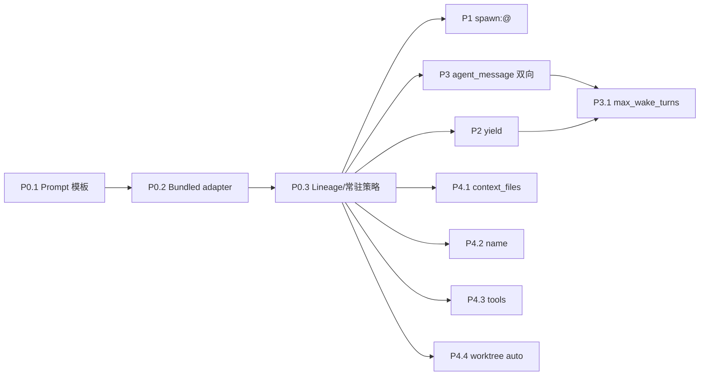

# Agent Delegation 实施计划（v2）

**状态**：P0–P4 已实现；P5 文档与 rollout 已实现（2026-11-11）。
**范围**：`agent` 工具的 `spawn:@<name>`、`yield`、`agent_message` 双向，以及 Delegation 相关的未满足项  
**非目标**：不实现 `agent://` / `local://` 通用 URI 协议；不做模型自定义 Python handler；不恢复 `delegate_task` 的新协作面

**关联代码**：

- `tools/agent_tool.py`
- `tools/agent_inbox.py`
- `tools/agent_message_tool.py`
- `tools/agent_out_tool.py`
- `tools/agent_definitions.py`
- `tools/subagent_worktree.py`
- `agent/agent_run.py`
- `agent/agent_session_runtime.py`
- `agent/turn_tool_round.py`
- `agent/agent_init.py`
- `agent/prompts/`
- `docs/bundled-agents/`
- `website/docs/user-guide/features/agent-tool.md`
- `website/docs/developer-guide/porting-omp-agents.md`

---

## 0. 已锁定决策

| 项 | 决策 |
|---|---|
| `agent` 并发 | 使用 `agent_loop.max_workers`；不再考虑 `delegation.max_concurrent_children` |
| blocking batch | 保持串行；`background=false` / `blocking: true` 按顺序执行 |
| `name` | 新增短名，独立于 `subject`；`agent_message` / `agent_out` 可按短名寻址 |
| `delegate_task` | 视为 legacy；新的子 agent 协作全部走 `agent` |
| eval 工具 | `tools` = 已注册工具名；自定义 handler 只走 host 侧 `extra_tools` |
| worktree | 默认 `auto` apply；冲突/父脏时保留分支并报告 |
| `agent_out` | 新增 `mode="context_files"`，支持 `local://`；`agent://` 由 `agent_out`（读）+ `agent_message`（写）分担 |
| bundled agents | `docs/bundled-agents` 转换后同名覆盖 `skills/agent-presets/agents`；`get_bundled_agents_dir` 指向该目录 |
| prompt 模板 | `agent/prompts/system/eager-*.md`、`irc-*.md`、`subagent-*.md` 接到实际渲染位置 |

---

## 1. 现状与差距

### 1.1 Delegation 策略模板未接线

`agent/prompts/renderer.py` 的 `render_tool_policy_from_config` / `render_closing` / `render_section` 只被测试导入。`agent/system_prompt.py` 与 `agent/prompt_builder.py` 没有调用它们，`09-tool-policy.md` 的 Delegation 策略在实际 system prompt 中不生效。

### 1.2 模板语法不一致

`eager-*.md`、`irc-*.md`、`subagent-*.md` 是 Handlebars（`{{#if}}` / `{{#each}}`），而 `agent/prompts/prompt_sections.py` 使用 Jinja2（`` / ``，`StrictUndefined`）。直接接线会输出字面量或报错。

### 1.3 bundled agents 是 omp 原始快照

`docs/bundled-agents` 使用 omp frontmatter（`tools`、`thinking-level`）和 omp 工具名（`read`、`find`、`grep`、`glob`、`bash`、`lsp`、`ast_grep`、`ast_edit`、`write`、`edit`、`eval`、`proc`），正文引用 `yield` / `agent://`。直接扫描会遮蔽可用的 Hermes 定义。

集合也不同：

- `docs/bundled-agents/`：`task, scout, reviewer, security-reviewer, seance, sonic`
- `skills/agent-presets/agents/`：`init, scout, reviewer, security-reviewer, seance, sonic`

若只做覆盖，`init` 会消失。

### 1.4 命名 agent 的 lineage 不对齐

`tools/agent_tool.py::_params` 传 `history_session=run.session_key`，但没有传 `session_id`。`agent_run.run()` 构造 `AIAgent(session_id=None)` 时会 mint 一个自己的 `sessions` id。命名 agent 调 `agent` 时，子 agent 的 `agent_session.parent_session_id` 记录的是这个 minted id，而不是父的 `agent_session_id`。这会让 named parent ↔ child 的 `agent_message` 授权失败。

### 1.5 常驻 session 丢失 `spawns` 与 depth

`_resident_spec()`（`tools/agent_tool.py:981`）没有持久化 `spawns`；`agent_session_runtime._run_turn()` 调 `agent_run.run/continue_run` 时没有设置 `_SPAWNS` / `_DEPTH`。park/revive 后，命名 agent 的定义 `spawns` 丢失，嵌套 `agent` 调用变成无限制，depth 也从 0 重新开始。

### 1.6 `yield` 工具不存在

当前契约是最终 assistant 消息即 handoff。`extra_tools` handler 只接收 `args`，没有通用的“执行完这个工具就停止”标志；不能用 `agent.interrupt()`，它会标记 turn interrupted 并可能跳过同批次剩余工具结果。

### 1.7 `spawn:@<name>` 不存在

目前只有结构化 `agent(agent_name=..., user_prompts=...)`。没有文本指令解析、body 规则、冲突校验。

### 1.8 `agent_message` 不是双向

`deliver_peer_message` 用 `_session_row()`（`agent_session` 表）解析目标：

- owner（主会话）→ child：可用。
- named agent ↔ named agent：可用。
- child → owning main conversation：`_session_row(target)` 返回 `None`，直接拒绝。

同时没有 sender envelope / `reply_to`，目标无法直接回信。

### 1.9 `max_wake_turns` 未强制

`wake_turns` 在 `deliver()` 里归零、在 `_after_turn()` 里递增，但没有任何比较。`_revive()` 也不检查 `wake_queue`。两个 resident peer 互答会无限唤醒。

### 1.10 其他未满足

- `name` 短名不存在；只有 `subject`。
- `tools` 没有 eval/注册名入口；`extra_tools` 未暴露。
- worktree 只保留分支，没有 auto-apply。
- `agent_out` 没有 `context_files` 模式；`_context_files()` 只返回 `(text, count)`，不持久化路径/大小/哈希。
- blocking batch 串行是现状，需要文档化与测试固定。

---

## 2. 契约

### 2.1 `spawn:@<name>`

新增 `agent.spawn` 字符串参数：

```json
{"spawn": "spawn:@reviewer\nMap the auth flow and report risks."}
```

语法：

```text
spawn:@<agent_name>
<optional blank line>
<task body>
```

规则：

- `agent_name`：`[A-Za-z0-9][A-Za-z0-9_.-]{0,63}`，禁止路径分隔符。
- body 必填；为空则拒绝。
- `spawn` 与 `agent_name` / `user_prompts` / `tasks` 互斥。
- 继续走 `_check_spawn_allowed()` + `MAX_DEPTH`；越权在创建 `agent_session` 行之前拒绝。
- `agent_message` 的正文不自动执行 `spawn:@`；接收方自己决定是否调用 `agent(spawn=...)`。

### 2.2 `yield` 工具

只对命名 agent 可用，通过 `agent_run.run(extra_tools=...)` 注入，不进入全局 `agents` toolset。

```json
{
  "data": {"type": ["object", "string"]},
  "type": {"type": ["string", "array"], "items": {"type": "string"}},
  "error": {"type": "string"},
  "final": {"type": "boolean", "default": true}
}
```

语义：

- `final=true`：终止本轮，`data` 成为最终输出；若定义带 `output_schema`，先校验，失败返回 tool error 让模型重试（有界）。
- `final=false`：记录一个增量 section，继续本轮。
- `error`：终止并记录错误；不丢弃已产出的 `data`。
- 没有调用 `yield` 时保持旧行为：最终 assistant 消息仍是 handoff。

实现要点：

- 新增 `tools/agent_yield_tool.py`，定义 `YieldState`。
- `agent_tool._params` 注入 `extra_tools=[build_yield_tool(state)]`；`on_agent` 把同一个 `state` 挂到 `agent._yield_state`。
- `agent/agent_init.py` 增加默认属性 `_yield_state = None`。
- `agent/turn_tool_round.py` 在 `_execute_tool_calls()` 之后、guardrail 分支之前检查 `state.payload`，设置 `final_response`、`_turn_exit_reason="yielded"`，append assistant row 后 break。
- 不使用 `agent.interrupt()`。
- 每个新 turn（wake/revive）开头 `state.reset()`，避免上一次 terminal yield 让下一次 wake 立刻 break。
- `AgentRunResult` 增加 `yield_data` / `yield_error` / `yield_sections`；`_settle` 写 structured output，`agent_out` 可读。

### 2.3 `agent_message` 双向

Envelope：

```text
<agent_message from="<sender_id>" from_subject="<subject>" reply_to="<inbox_id>" progress="false">
<body>
</agent_message>
```

规则：

- `from` 由服务端根据 dispatch 身份解析，模型不能伪造。
- 新增 `reply_to` 参数；目标可直接 `agent_message(to="<from>", reply_to="<inbox_id>", ...)`。
- 双向范围：
  - named agent ↔ named agent：parent/child/sibling。
  - child → owner：目标解析回退到 `sessions` 行；授权 `sender.parent_session_id == target`；投递走 `process_registry.completion_queue`，`role="agent_message"`、`session_key=<owner>`。
  - owner 不在线：明确返回 `pending` 或限制；不要假装已送达。
- `agent_out(mode="inbox")` 暴露 `sender` / `reply_to` / `progress` / `kind`。

### 2.4 `name` 短名

- `agent` 单调用和 `tasks[]` 增加 `name`。
- 规则：CamelCase，≤32，profile 内唯一；省略时自动生成 `<AgentName><4hex>`。
- `agent_session` 增加 `short_name` 列（迁移）；`begin_agent_session` 写入；`get_agent_session_by_name`。
- `agent_message` / `agent_out` 解析顺序：`agent_session_id` → `name` → `subject`。

### 2.5 `tools` / `extra_tools`

- `agent` / `tasks[]` 增加 `tools`：已注册工具名数组，映射到 `enable_tools`。
- 未知工具名 fail closed；不把 typo 扩大成全量工具。
- 自定义 handler 只通过 host 侧 `agent_run.run(extra_tools=...)` 注入；模型 schema 不接受 handler。
- `agent_run.run()` 已接受 `extra_tools`；`agent_tool` 需要把 `tools` 与 `extra_tools` 正确合并。

### 2.6 `agent_out(mode="context_files")`

新增 dataclass：

```python
@dataclass(frozen=True)
class ContextInput:
    raw: str          # local://foo or relative path
    resolved: str     # realpath
    bytes: int
    sha256: str
```

改动：

1. `_context_files()` 返回 `(text, tuple[ContextInput, ...])`。
2. `_Run` 增加 `context_inputs`。
3. `_resident_spec` 增加 `context_inputs`。
4. `agent_session.metadata_json` 写入 `context_inputs`。
5. `agent_out(mode="context_files")` 返回路径/大小/哈希；`include_content=true` 时再读文件，受既有大小限制。
6. `local://<path>` 解析在 `_context_files`、`task_file`、`agent_out` 中共用同一个 resolver：项目相对路径、`realpath` 后必须在 `_allowed_roots` 内、拒绝绝对路径逃逸和 NUL。

`agent://` 不实现 URI：

- 读：`agent_out`（history/artifact/ast_summary/inbox/context_files）
- 写：`agent_message`
- 文档写清映射。

### 2.7 worktree auto-apply

`isolated` / `worktree` 默认 `apply="auto"`。

完成后：

1. 父工作区不 clean → 保留分支，`applied=false`，报告原因。
2. 子工作区 dirty → 在子分支 commit。
3. `git merge --no-ff --no-edit <branch>`；冲突则 `git merge --abort`，保留分支。
4. 成功 → `applied=true`，再 archive/prune。

`AgentRunResult.worktree` 增加 `applied` / `apply_error` / `merge_commit`。

### 2.8 bundled agents

`docs/bundled-agents` 是源，但需要 build-time adapter，不能直接扫描。

新增 `scripts/build_bundled_agents.py`：

- 读取 `docs/bundled-agents/*.md`。
- 转换 frontmatter：
  - `tools` → `enable_tools`，按以下映射转换（左列为 omp 工具名，右列为 Hermes 实际用法）：

    | omp | Hermes |
    |---|---|
    | `read` | `read_file` |
    | `find` | `judgrg` |
    | `grep` | `terminal` 中使用 `rg` |
    | `glob` | `terminal` 中使用 `rg` |
    | `bash` | `terminal` / `process` |
    | `lsp` | `code_intel` |
    | `web_search` | `web_search` |
    | `ast_grep` | `terminal` 中使用 `ast-grep` |
    | `ast_edit` | `terminal` 中使用 `ast-grep` |
    | `write` | `write_file` |
    | `edit` | `patch` |
    | `eval` | `execute_code` |
    | `proc` | `process` |

    注：`process` 是 omp→Hermes 的映射名；当前 Hermes 注册工具是 `process_manage`，转换器在 `enable_tools` 中输出 `process_manage`，文档保留 `process` 以便与你的映射表一致。  
    另：`enable_tools` 只能输出工具名，不能输出用法别称。因此 `grep` / `glob` / `ast_grep` / `ast_edit` 统一输出 `terminal`；`bash` 输出 `terminal`（需要后台进程时额外允许 `process_manage`）；`proc` 输出 `process_manage`。“使用 `rg` / `ast-grep`”是正文或提示中的操作指引，不是工具名。
  - `thinking-level` → `reasoning_effort`；`auto` → 空
  - `output` → 复用 `agent_definitions.normalize_output()`（已支持 omp 的 `metadata/elements/optionalProperties`）
  - `spawns` / `blocking` / `read-summarize` 已支持
- 转换正文：
  - `yield` 保留，语义改为新 terminal-yield 工具
  - `agent://<id>` → `agent_out`（读）/ `agent_message`（写）
  - `write ... agent://` → `agent_message(to=..., content=...)`
  - `proc://` → `process`（当前注册工具为 `process_manage`）
- 输出到 `skills/agent-presets/agents/`（同名覆盖），由 `HERMES_BUNDLED_AGENTS` 指向。
- 未知字段/未知工具名 fail closed。

发现顺序：

1. project
2. profile
3. bundled agents (converted)
4. `skills/*/agents`（含 `agent-presets`）
5. plugins

同名 first-wins：bundled 覆盖 `skills/agent-presets/agents`；`init` 只存在于 skill pack，继续保留。

最终 shipped set：

```text
task, init, scout, reviewer, security-reviewer, seance, sonic
```

### 2.9 prompt 模板

Handlebars → Jinja 一次性转换：

- `{{#if x}}` → ``
- `{{#unless x}}` → ``
- `{{#each xs}}` → ``
- `{{x}}` → `{{ x }}`

| 模板 | 接线位置 | 改写 |
|---|---|---|
| `eager-task.md` | `delegation.eager_tasks=true` 时的每轮 context | `toolRefs.agent` → `agent`；`taskBatch` → `tasks[]` |
| `eager-todo.md` | 强制 todo 路径 | `toolRefs.todo_list` → `todo_list` |
| `irc-incoming.md` | `agent_message` 投递 envelope | `write agent://` → `agent_message`；`yield` → terminal yield；progress → `agent_message(progress=true)` |
| `subagent-role.md` | child system prompt 的 Role/Context/Peers/Completion | `render_subagent_role(self_id, peers, completion, plan_reference)` |
| `subagent-system-prompt.md` | named/delegate child 的完整 system prompt | `ircSelfId`/`ircPeers` → `name`/peers；`write agent://` → `agent_message` |
| `subagent-user-prompt.md` | child assignment 包装 | `assignment` |
| `subagent-async-pending.md` | yield 后仍有 background job | `proc://` → `process`；`yield` → 新工具 |
| `subagent-completion-probe.md` | orchestrator 探测 in-flight 子 agent | `inflight` |
| `subagent-yield-reminder.md` | 迭代/预算耗尽前强制 wrap-up | `yield` → 新工具 |

`agent/prompts/system/manifest.json` 增加这些 key/path/context_keys/renderer；`agent/prompts/renderer.py` 增加对应 `render_*`。

测试：所有 wired 模板渲染后不包含 `{{`，且 `StrictUndefined` 下缺 key 会失败。

---

## 3. 阶段计划

### P0.1 Prompt 模板接线

改动：

- Handlebars→Jinja 转换。
- `manifest.json` 增加条目。
- `renderer.py` 增加 renderers。
- `agent/system_prompt.py` 接入 `tool_policy`；`eager-task` 走每轮 context，不改稳定前缀。
- `agent/agent_run.py` 的 child system/user prompt 改用 `subagent-system-prompt.md` + `subagent-user-prompt.md`。
- `agent/agent_session_runtime._run_turn` 的 wake/revive 走同一套渲染。

测试：

- `tests/agent/test_prompt_live_wiring.py`
- 每个模板渲染无 `{{`。
- 生产 system prompt 包含 Delegation policy。

### P0.2 Bundled agents adapter

改动：

- `scripts/build_bundled_agents.py`。
- `get_bundled_agents_dir(root)` / `HERMES_BUNDLED_AGENTS`。
- `tools/agent_tool.py::_base_agent_dirs` / `_prompt_scopes` 扫描顺序。
- `agent_definitions` 增加 `tools` / `thinking-level` 归一化（或只接受转换后的文件）。
- 打包/Docker/Nix 提供 `skills/agent-presets/agents/`（`HERMES_BUNDLED_AGENTS` 指向它）。

测试：

- shipped set 精确匹配 7 个名字。
- 同名 `scout` 解析到 bundled。
- `init` 仍可用。
- 转换后无 `agent://`、无 `{{`、所有工具名可解析。

### P0.3 Lineage 与常驻策略

改动：

- `agent_run.run()` 增加 `parent_session_id`，传给 `AIAgent`。
- `agent_tool._params` 设置 `session_id=run.agent_session_id`、`parent_session_id=run.session_key`、`meta.parent`。
- `agent_session_runtime._revive_params` 同样设置。
- `_resident_spec` 持久化 `spawns` / `spawn_depth`。
- `agent_session_runtime._run_turn` 用 `nested_spawn_policy(spawns, depth)` 包裹 `continue_run` 和 `agent_run.run`。

测试：

- 嵌套 named agent 的 `parent_session_id` 等于父 `agent_session_id`。
- parent↔child `agent_message` 授权通过。
- revive 后 allowed/disallowed spawn 与 depth 仍生效。

### P1 `spawn:@<name>`

改动：

- `agent` schema 增加 `spawn`。
- `_parse_spawn_directive()`。
- `_validate()` 前置归一化与冲突检查。
- 复用 `_check_spawn_allowed()` + `MAX_DEPTH`。

测试：

- 合法/非法、空 body、allowlist、depth、与 batch 冲突。
- peer 文本不自动 spawn。

### P2 `yield`

改动：

- `tools/agent_yield_tool.py`（`YieldState`）。
- `agent_tool._params` 注入 extra tool。
- `agent/agent_init.py` 默认属性。
- `agent/turn_tool_round.py` 检查并 break。
- `AgentRunResult` 字段与 `_settle` / `agent_out`。
- 每个 turn 开头 `reset()`。

测试：

- 终止、schema 重试、error、incremental。
- wake 后不误 break。
- revive 保留工具。

### P3 `agent_message` 双向

改动：

- `deliver_peer_message`：envelope、`reply_to`、owner fallback、completion queue。
- `agent_message_tool`：`to`（id/name/subject）、`name`、`reply_to`、`progress`。
- `agent_out(mode="inbox")` 暴露字段。
- `max_wake_turns` 链式计数（`chain_id`/`hops`），`deliver` 与 `_revive` 都检查。

测试：

- envelope、reply、sibling/parent/child/owner。
- 陌生 sender、跨 profile、转义。
- hop 上限、owner 不在线。

### P4.1 `context_inputs` 与 `agent_out(mode="context_files")`

改动：

- `_context_files()` 返回 `ContextInput` 列表。
- `_Run` / `_resident_spec` / `agent_session.metadata_json` 持久化。
- `agent_out` 增加 mode。
- `local://` resolver 共用。
- `task_file` / `context_files` 支持 `local://`。

测试：

- 模式返回路径/大小/哈希。
- revive 后仍可见。
- `local://` 越界拒绝。
- `include_content` 限制。

### P4.2 `name` 短名

改动：

- `agent` / `tasks[]` schema 增加 `name`。
- `agent_session.short_name` 列 + 唯一索引。
- `begin_agent_session` / `get_agent_session_by_name`。
- `agent_message` / `agent_out` 解析顺序。

测试：

- 唯一性冲突、长度/字符校验、按短名寻址。

### P4.3 `tools` / `extra_tools`

改动：

- `agent` / `tasks[]` 增加 `tools`。
- 映射到 `enable_tools`；未知名 fail closed。
- host `extra_tools` 注入。
- 不把 handler 暴露给模型 schema。

测试：

- 注册名过滤、未知名拒绝。
- host extra_tools 可调用且不泄漏。

### P4.4 worktree auto-apply

改动：

- `subagent_worktree` 增加 apply 步骤。
- `agent_run._finalize_worktree` 传递 apply 模式。
- `AgentRunResult.worktree` 增加字段。

测试：

- 成功 merge、父脏拒绝、冲突保留分支、零改动 prune。

### P4.5 blocking batch 串行

- 明确为设计行为，不修并发。
- 更新 schema description / docs / 测试：
  - `tasks[]` 默认后台并发。
  - `background=false` / `blocking: true` 在调用线程按顺序执行。

### P5 文档与 rollout（已实现，2026-11-11）

- 更新 `website/docs/user-guide/features/agent-tool.md`：`spawn`、`yield`、`agent_message`、
  `context_files`、worktree auto-apply、blocking batch 语义与三个 rollout 开关。
- 更新 `website/docs/developer-guide/porting-omp-agents.md`：
  - `yield` 不再是 non-goal（实现为 named-agent 的 per-run 工具）。
  - peer messaging 改由 `agent_message` 承担；`agent://` 仍不是 URI。
  - `spawns` 已是 frontmatter key，修正过期行。
- 更新 ADR-15 P5/P6 状态：P5 已实现，记录“独立 `agent_message`、无 broadcast、无独立
  `interrupts` 队列”的设计修订。
- 增加 changelog：见本文 §8（发布说明按仓库既有约定由 conventional commits 生成）。
- 灰度开关（默认开启，设为 `false` 回退旧行为）：
  - `agent_sessions.yield_tool` — 不注入 per-run `yield` 工具。
  - `agent_messages.envelope` — 投递转义正文，不带 `from`/`reply_to` envelope。
  - `delegation.spawn_directive` — 拒绝 `spawn:@<name>`，只保留结构化参数。

---

## 4. 测试矩阵

| 文件 | 覆盖 |
|---|---|
| `tests/agent/test_prompt_live_wiring.py` | 生产 prompt 包含 Delegation；模板无 `{{`；缺 key 失败 |
| `tests/tools/test_bundled_agents.py` | shipped set、覆盖关系、转换后解析、工具名 |
| `tests/tools/test_agent_spawn_directive.py` | `spawn:@` 解析、冲突、allowlist、depth |
| `tests/tools/test_agent_yield.py` | `YieldState`、终止、schema、reset、revive |
| `tests/tools/test_agent_message.py` | envelope、reply、双向、owner、hop 上限 |
| `tests/tools/test_agent_tool.py` | lineage、name、tools、blocking batch 串行 |
| `tests/tools/test_agent_session_runtime.py` | revive 后 `spawns`/depth、wake 链 |
| `tests/tools/test_agent_out_context_files.py` | `context_files` 模式、`local://` |
| `tests/tools/test_subagent_worktree_apply.py` | auto merge、冲突、父脏 |

命令：

```bash
scripts/run_tests.sh \
  tests/tools/test_agent_tool.py \
  tests/tools/test_agent_message.py \
  tests/tools/test_agent_session_runtime.py \
  tests/tools/test_agent_spawn_directive.py \
  tests/tools/test_agent_yield.py \
  tests/tools/test_agent_out_context_files.py \
  tests/tools/test_bundled_agents.py \
  tests/tools/test_subagent_worktree_apply.py \
  tests/agent/test_prompt_live_wiring.py -q
python scripts/check
```

E2E：

- 两个 named agent 用短名互发，目标看到 envelope 并回复；各自 `yield`；父用 `agent_out` 读回。
- 一个 agent park/revive 后仍保留 `spawns`、depth、yield 工具、peers。
- worktree 子 agent 成功后 auto-merge 到父；冲突时保留分支。
- `spawn:@scout` 与 `tasks[]` 批量混合时行为符合预期。

---

## 5. 风险与回滚

| 风险 | 控制 |
|---|---|
| prompt cache 被破坏 | `tool_policy` 放 stable/context 初始构建；`eager-task` 走每轮 context，不改稳定前缀 |
| Handlebars 转换遗漏 | 渲染测试断言无 `{{`；`StrictUndefined` |
| bundled 定义字段不兼容 | build-time adapter；未知字段/工具名 fail closed；CI 重新生成无 diff |
| auto-merge 冲突 | 失败保留分支并报告；父脏直接拒绝 |
| yield 工具面变化 | per-run `extra_tools`；配置开关 `agent_sessions.yield_tool` |
| wake 循环 | `max_wake_turns` 链式计数；超限 pending |
| short name 冲突 | profile 内唯一索引；创建前拒绝 |
| `local://` 越界 | 复用 `_allowed_roots`，realpath 校验 |
| lineage 改动影响 `agent_out` | 测试 `agent_session` 与 `sessions` 区分；`_is_conversation` 回归 |

---

## 6. 依赖顺序



说明：

- P0.1 是前提，否则模型看不到策略与工具用法。
- P0.3 是 spawn / message 的前提，否则 lineage 授权错误。
- P2 与 P3 可并行；`max_wake_turns` 必须在 peer 双向默认开启前完成。
- P4.x 可在 P0.3 后并行。

---

## 7. 验收总表

- [ ] 生产 system prompt 包含 Delegation policy。
- [ ] 所有 wired 模板渲染无 `{{`。
- [x] shipped agent set = `task, init, scout, reviewer, security-reviewer, seance, sonic`。
- [x] bundled 转换后无 `agent://`，所有工具名可解析。
- [x] `spawn:@<name>` 通过 allowlist/depth，未知/越权在建行前拒绝。
- [x] `yield` 终止本轮，schema 失败有界重试，wake 后不误 break。
- [x] `agent_message` named↔named 双向；child→owner live 可达；envelope/reply 正确。
- [x] `max_wake_turns` 在 `deliver` 与 `_revive` 都生效。
- [x] revive 后 `spawns`/depth 仍生效。
- [x] `agent_out(mode="context_files")` 在 revive 后仍返回完整输入。
- [x] `name` 短名唯一且可寻址。
- [x] `tools` 只接受注册名；host `extra_tools` 不泄漏。
- [x] worktree auto-apply 成功/冲突/父脏三条路径都有测试。
- [x] blocking batch 串行有文档与测试固定。

---

## 8. 变更记录（P5 rollout）

用户可见变化，供发布说明归类：

- **新增** `agent(spawn="spawn:@<name>\n<body>")` 文本指令；仍受 `spawns` allow-list 与
  `MAX_DEPTH` 约束，与结构化参数互斥。
- **新增** named agent 的 per-run `yield` 工具：终止本轮并返回结构化答案，支持增量 section、
  schema 有界重试与 `error`；未调用时保持最终 assistant 消息契约。
- **新增** `agent_message` 双向协作工具：owner/sibling/child 授权、short `name` 寻址、
  服务端 envelope 与 `reply_to`、child→owner 回传、`progress` 标记；超 `max_wake_turns`
  只保留 pending。
- **新增** `agent_out(mode="context_files")`：返回 spawn 时的 `raw`/`resolved`/`bytes`/`sha256`，
  `include_content` 走同一 `local://` resolver 与预算。
- **新增** `agent` / `tasks[]` 的 `name` 短名（profile 唯一）与 `tools` 注册工具 allowlist。
- **变更** worktree 默认 auto-apply：父工作区 clean 时自动 merge，冲突/父脏保留分支并报告。
- **澄清** blocking `tasks[]` 按数组顺序串行，后台 batch 使用 `agent_loop` 并发。
- **Rollout 开关**（默认开启，`false` 回退）：`agent_sessions.yield_tool`、
  `agent_messages.envelope`、`delegation.spawn_directive`。

发布说明按仓库既有约定由 conventional commit 生成，不新增独立 `CHANGELOG.md`。
