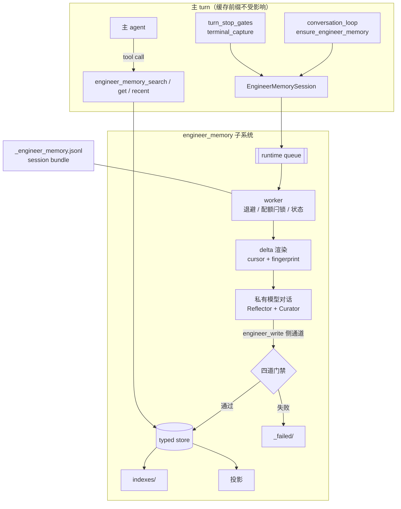

# Engineer Memory Taxonomy v2：与 native advisor 平级的 Hermes 后台评审子系统

> 状态：设计草案（Design Draft）。只定义架构、契约与实施顺序，不含实现代码。
> `[verified]` = 来自本仓库代码；`[design]` = 本设计的取舍。

---

## 0. TL;DR

1. **它是 Hermes 的一个核心子系统。** 形态与 native advisor 完全平级：`agent/engineer_memory_*` 一组兄弟模块 + 两处 turn 挂载点，观察主会话、后台跑私有模型对话、把结论写进类型化知识库。
2. **主 agent 的提示词与缓存前缀不被触碰。** 评审只在 turn 边界捕获一份快照，写路径在后台；读路径是主 agent 主动调用 `engineer_memory_search`（core toolset），不是自动注入。
3. **ACE 提供循环，taxonomy 提供形状。** ACE 的 playbook 是“一段可增删文本 + helpful/harmful”，无类型、无来源、无生命周期；六类记忆补上这一层，Reflector/Curator 才有可校验的落点。

---

## 1. 事实基础

### 1.1 Hermes 已有同类子系统：native advisor `[verified]`

`agent/advisor_*.py` 是本设计的直接原型，它已经解决了“后台评审一个活会话”的全部难点：

| 机制 | 位置 | 事实 |
|---|---|---|
| 懒挂载 | `agent/advisor_bridge.py: ensure_advisor` | 首次 turn 才创建 `AdvisorSession`；配置关闭时零开销；cron / detached fork 不宿主 reviewer |
| turn 挂载点 | `agent/conversation_loop.py:1845`、`agent/turn_tool_round.py:299`、`agent/turn_stop_gates.py:341` | 分别对应“本轮开始”“工具轮结束”“终局答案前” |
| 增量渲染 | `agent/advisor_delta.py` | 只渲染 cursor 之后的尾部；fingerprint 检测前缀被改写（压缩/undo/branch）则回卷重放；单条消息上限 24k；append-only、字节稳定 |
| 私有模型对话 | `agent/advisor_model.py` | 每个 reviewer 一条私有会话；每个 delta 批次作为**独立 user 消息**追加（缓存友好）；侧通道只有 `advise` 工具 |
| 发射守卫 | `agent/advisor_emission.py` | 去噪、同键折叠、单批预算、升级 |
| 记录 | `agent/advisor_recorder.py` | `<session bundle>/_advisor.jsonl`；是遥测，不是会话状态 |
| 队列/重试 | `agent/advisor_runtime.py` | per-advisor queue + worker + 退避 + 配额闩锁 + 状态 |
| 只读工具 | `agent/advisor_config.py: DEFAULT_TOOL_NAMES` | 默认 `read_file` / `search_files` |

**结论**：Engineer Memory 不需要发明新的后台机制，只需要照这套形状再长一个兄弟子系统，把侧通道从 `advise` 换成 `engineer_write`，把落点从“建议”换成“类型化知识库”。

### 1.2 为什么不是 MemoryProvider `[verified + design]`

- `MemoryProvider` 由 `agent/memory_manager.py` 每轮调用，`prefetch` 要求“fast + 回缓存结果”，天然处在热路径，且占用唯一 active 槽位。
- 它的产物进入本轮上下文，意味着要动提示词；本子系统的产物是磁盘写入，与上下文无关。
- 评审需要独立模型、独立预算、可取消——这些都是 provider 契约没有的位置。

### 1.3 ACE 的真实机制 `[verified，源码]`

| 组件 | 行为 | 源码 |
|---|---|---|
| 存储 | 单个文本 playbook，`## section` 分节，行格式 `[id] helpful=X harmful=Y :: content` | `playbook_utils.py` |
| Generator | 用当前 playbook 生成推理轨迹与答案 | `ace/core/generator.py` |
| Reflector | 给用到的 bullet 打 `helpful / harmful / neutral`，并产出文字反思 | `ace/core/reflector.py` |
| Curator | 输出纯 JSON `{reasoning, operations:[{type, section, content}]}` | `ace/prompts/curator.py` |
| 实际支持的 op | **只有 ADD**；UPDATE/MERGE/DELETE/CREATE_META 仍是注释里的 TODO | `playbook_utils.py: apply_curator_operations` |
| 预算 | `playbook_token_budget`、`curator_frequency`、`online_eval_frequency`、`save_steps` | `README.md` |
| 统计口径 | `helpful > 5 && harmful < 2` high-performing；`harmful >= helpful > 0` problematic；`helpful + harmful == 0` unused | `get_playbook_stats` |
| 反模式防护 | 增量 delta、禁止整体重写、去重、剪枝（grow-and-refine） | `README.md`、curator prompt |

### 1.4 能力差：ACE 有循环，taxonomy 有形状

| 维度 | ACE playbook | Taxonomy v2 | 结论 |
|---|---|---|---|
| 结构 | 自由文本 + section | 六类 + schema + registry | taxonomy 提供可校验结构 |
| 身份 | 自增 `slug-00001` | `class + kind + topic`（事件另用 ULID） | 稳定去重键 |
| 来源 | 无 | `source_session / evidence / relations` | 可溯源 |
| 时间 | 无 | `time / updated_at / lifecycle` | 有时效与失效 |
| 变更 | ADD（其余 TODO） | create/revise/merge/forget/link/promote/demote | delta 思想可用，代码不可直接用 |
| 归因 | reflector 打标签 | 读取记录 + 结果信号 | 需自建归因 |
| 自改进 | offline/online 循环 | 无 | 借用三角色与三模式 |

---

## 2. 设计决策

**D1（形态）** 与 native advisor 平级的核心子系统：`agent/engineer_memory_*` + 两处 turn 挂载点（本轮开始 / 终局）+ 一条私有模型对话。
理由：advisor 已验证了懒挂载、增量渲染、私有对话、预算、取消、记录这一整套；“后台评审一个活会话”不需要第二种实现。

**D2（观察点只在终局）** advisor 在“工具轮结束 + 终局”两处捕获；engineer 只在**终局**捕获。
理由：知识归档关心的是“这一轮的结果”，工具轮中间态对最终结论没有增量价值；少一个挂载点即少一半评审成本，而终局快照里已经包含全部工具结果与错误。

**D3（ACE 的定位）** 只借三角色、delta 词汇、计数与剪枝口径；不用其 playbook 格式，不 vendoring 其仓库。
理由：其 `playbook_utils.py`/`llm.py`/`utils.py` 是顶层模块而非可安装包，核心只实现 ADD；直接依赖会把“单文本 + ADD-only”带进来（Apache-2.0，移植时保留出处）。

**D4（写权在代码）** 模型只输出 ops（经 `engineer_write` 侧通道），应用 ops 的是 store 写入器。
理由：结构性消除幻觉写入与并发写；对齐 ACE 的 curator——“模型出 JSON，代码应用”。

**D5（读路径是工具）** 主 agent 通过 core toolset `engineer_memory` 的只读工具取记忆；v1 **不做**自动注入。
理由：注入要动上下文与缓存；按需拉取把成本放到真正需要记忆的轮次。可选 push 通道在 §3.4 单列，默认关闭。

**D6（写入门禁）** 四道闸：schema、registry、identity 去重、预算。任何一道失败都**不降级写**，落 `_failed/` 并保留旧页。

**D7（主分类轴）** 六类升为 `class`，`KNOWLEDGE/VALUE/INTENT/METHOD/GOVERNANCE` 降为 `kind` facet。
理由：主索引只能有一个；双主轴会让“按类别选目录”与“按读者用途选类别”互相污染。

**D8（与 advisor 的边界）** 两个评审共享 turn 挂载点与增量渲染，但**不共享模型调用、提示词、产物或配置**：
- advisor 回答“此刻该提醒什么”，产物是 `advise` 笔记；
- engineer 回答“什么值得永久记住”，产物是 typed store；
- 两者的队列、重试、预算、记录各自独立，故障隔离。

---

## 3. 总体架构

### 3.1 模块与数据流



三条通道：turn 边界快照（单向观察）、`engineer_write` 侧通道（模型 → 门禁）、只读工具（主 agent 拉取）。评审从不改主会话的提示词。

### 3.2 与 advisor 的对照

| 维度 | native advisor | engineer memory |
|---|---|---|
| 挂载点 | 工具轮 + 终局 | 仅终局 |
| 输入 | append-only delta（含 reasoning） | 同一份 delta + 结果信号（测试/错误/纠正） |
| 模型对话 | 私有，`advise` 侧通道 | 私有，`engineer_write` 侧通道 |
| 守卫 | emission guard（去噪/去重/预算） | write guard（schema/registry/identity/预算） |
| 产物 | 建议 → 投递回主 turn | 文件 → 知识库，**不回灌上下文** |
| 记录 | `_advisor.jsonl` | `_engineer_memory.jsonl` |
| 配置 | `advisor:` + `WATCHDOG.yml` | `engineer_memory:` |

### 3.3 进程、作用域与调度

| 组件 | 运行位置 | 约束 |
|---|---|---|
| `ensure_engineer_memory` | turn 线程 | 懒创建；配置关闭时返回 `None`，零开销 |
| `terminal_capture` | turn 线程（终局前） | 只做快照入队；观测失败绝不阻塞 turn（与 `step_review` 同款 try/except） |
| worker | `EngineerMemoryRuntime` 自带线程 | **每 agent session（每 reviewer）一条**，随 `EngineerMemorySession` 存活与销毁；退避重试；配额闩锁；`status()` 可查 |
| delta 渲染 | worker 内 | 复用 `agent/advisor_delta.py`：cursor 之后才渲染，前缀改写则回卷 |
| 模型调用 | worker 内 | 独立路由 `engineer_memory.model/provider`；超时、`max_input_tokens` |
| 写入 | worker 内收尾 | 单写者事务 + 原子替换 + 每 identity 文件锁 |
| 记录 | worker 内 | JSONL append；失败重试按同一 user delta 重放，不重复写 |

**作用域**：session 创建时显式绑定该 agent 的 `hermes_home`，runtime、worker 与记录器都继承这个绑定；不设进程级单例，也不在 worker 里回读环境变量。多 profile 同进程时，评审结果只会落到发起它的那个 home，与 advisor 的 per-session 绑定一致。

### 3.4 交付通道（可选，默认关闭）

v1 不向主 turn 注入任何内容。若未来需要“本轮有高度相关经验”的提示，复用 advisor 已验证的边界语义，而不是新造通道：

- 形态：append-only 的 `role:"user"` 行，`display_kind="engineer-memory"`，只在 turn 边界落；
- 预算：每次 ≤ 3 条、≤ 900 字符（与 advisor 的 `MAX_BLOCK_CHARS` 同量级）；
- 开关：`engineer_memory.deliver: off | aside | card`，默认 `off`；
- 必须先证明 pull 的 `recall_hit_rate` 不足，否则不开启。

---

## 4. 数据模型

### 4.1 六类契约

| 类 | identity | 必填 | 合并策略 | 生命周期 | 保留 |
|---|---|---|---|---|---|
| Entities | `class + subcategory + slug(topic)` | `identity, attributes, scope` | 同一 identity 原地修订；属性冲突不覆盖，双方保留并互标 `contradicts` | active/superseded/deprecated | 永久，deprecated 进 archive |
| Events | `event_id`（ULID）+ 日流 | `ts, type, actor, object, action, result` | **不合并**，只追加 | immutable | 日流 400 天；records 永久 |
| Trajectories | `class + subject + goal` | `subject, goal, states[]`（≥2 个带时间的 state） | 追加 state；状态回退必须带 `caused_by` | active/stalled/completed/abandoned | 永久 |
| Experiences | `class + trigger + slug(lesson)` | `trigger, symptom, cause, fix, lesson, evidence_refs` | 同一 lesson 修订；不同 cause 视为不同单元 | active/deprecated | 永久；unused 衰减 |
| Tools | `class + subcategory + name + version` | `invocation, inputs, limits, works, fails, verified_at` | 版本为不同单元，旧版标 `superseded` | active/superseded/removed | 永久 |
| Projects | `class + project_slug` | `goal, deliverables[], state` | 子页（需求/架构/决策/任务/测试/部署/风险）独立身份 | active/paused/archived | 永久 |

**硬规则**：events 必须有日期、至少一个 object、≥2 行（动作 + 结果）；projects 必须同时说出 goal、deliverable、state，否则按“它实际陈述的东西”归档。

### 4.2 统一 frontmatter

```yaml
schema: engineer-memory/2
class: entities | events | trajectories | experiences | tools | projects
kind: knowledge | value | intent | method | governance   # facet
id: ent-01J...            # 稳定身份，slug 或 ULID
topic: <2–40 字符名词短语>
epistemic: fact | inference | hypothesis | prediction   # 仅 kind=knowledge 允许
confidence: 0.0–1.0
status: active | superseded | deprecated | archived
time: YYYY-MM-DD
updated_at: ISO8601
revisions: <int>
objects: ["tools:Docker", "projects:omp"]
relations: [{type: supersedes, target: <id|path>}]
evidence: ["evidence/code/abc123", "events/streams/2026/11/08.jsonl#evt-..."]
source_session: <session_id>
summary: <≤120 字符>
helpful: 0                # 归因计数器，见 §5.4
harmful: 0
content_hash: <sha256>
```

约束：`epistemic` 只能出现在 `kind=knowledge`；`fact` 必须有非空 `evidence`；`hypothesis/prediction` 永远不能被自动提升为 `fact`。

### 4.3 Events 的三层

| 层 | 位置 | 写者 | 读者 | 说明 |
|---|---|---|---|---|
| 流 | `events/streams/<yyyy>/<mm>/<dd>.jsonl` | 写入器 | Curator、投影 | 只追加，一行一事件；日切割 |
| 记录 | `events/records/{decisions,project-changes,development,execution,feedback,incidents}/` | Curator（从流提升） | 检索工具 | 有正文、关系、证据的独立页 |
| 投影 | `events/projections/{daily,weekly,monthly}/` | cron | 人、review | 物化聚合视图，带 watermark；可重建 |

**单一事实源**：流是事实；记录是流的视图；投影是记录的视图。

### 4.4 目录布局

```text
engineer-memory/
├── _system/
│   ├── SPEC.md  MEMORY_TYPES.md  HEADING_SPEC.md
│   ├── FRONTMATTER_SPEC.md  RELATION_SPEC.md
│   ├── EVENT_SPEC.md  LIFECYCLE_SPEC.md
│   ├── schemas/{entity,event,trajectory,experience,tool,project}.schema.yaml
│   ├── templates/{entities,events,trajectories,experiences,tools,projects}/*.md
│   ├── registries/{heading,category,subcategory,relation,event-type}-registry.yaml
│   └── policies/{extraction,deduplication,conflict-resolution,retention,confidence}-policy.md
├── entities/{persons,organizations,technologies,concepts,environments,constraints}/
├── events/{streams,records,projections}/
├── trajectories/{projects,decisions,learning,development,collaboration}/
├── experiences/{debugging,best-practices,anti-patterns,experiments,incidents,collaboration}/
├── tools/{languages,frameworks,libraries,databases,cli,infrastructure,agents,models,protocols}/
├── projects/{active,paused,archived}/<project>/{PROJECT.md,requirements,architecture,decisions,
│         modules,interfaces,tasks,tests,deployments,risks,deliverables}/
├── sessions/{<yyyy>/<mm>/,summaries}/          # 原始交互（只读证据）
├── evidence/{documents,code,logs,screenshots,reports,external-references}/
├── adviser/{findings,recommendations,reviews,outcomes,rules,reports}/
├── indexes/{master,entity,event,project,relation}-index.md + fulltext/
└── archive/{superseded,deprecated,imported}/
```

`adviser/` 是本子系统自己的评审产物目录：`findings`（观察到什么）、`reviews`（本次提示词 / delta / ops / 门禁结果）、`outcomes`（写入后是否被后续轮次引用）。它是审计记录。

### 4.5 示例

事件流一行：

```json
{"id":"evt-01JBK3","ts":"2026-11-08T10:12:03Z","type":"deployment","actor":"hermes","object":"projects:omp","action":"rollout gateway 0.22.4","result":"ok","session":"s-7f2a","evidence":["evidence/logs/gw-1108.log"],"relations":[{"type":"part_of","target":"traj-omp-upgrade"}]}
```

经验页（节选）：

```markdown
---
schema: engineer-memory/2
class: experiences
kind: method
id: exp-msys-path-cd
topic: MSYS bash 无法 cd Windows 盘符路径
status: active
evidence: ["evidence/logs/msys-20261108.log"]
helpful: 3
harmful: 0
---

## Trigger
在 Windows 上的 bash 工具里执行 `cd C:/...`。
## Symptom
返回“文件名、目录名或卷标语法不正确”。
## Cause
该 shell 的路径层把 `C:/` 当作含冒号参数，而非驱动器挂载。
## Fix
改用 `ls "C:/..."` 或在支持的环境里用 `/c/...`。
## Lesson
路径解析失败先换访问方式，不要在工具层反复重试。
```

---

## 5. ACE 适配：从 playbook 到 typed store

### 5.1 角色映射

| ACE | v2 对应 | 差异 |
|---|---|---|
| Generator | **主 agent**（轨迹免费产生） | 不额外调用；轨迹来自 turn 快照 |
| Reflector | 私有对话里的反思 pass | 输出“候选单元 + 归因标签”，不是 bullet 标签 |
| Curator | 私有对话里的策展 pass | 输出七类 delta；落地前过 schema/registry |
| Playbook | typed store | 一段文本 → 六类文件 + 事件流 |
| Section | `class`（+ `kind` facet） | 封闭枚举，未知值直接拒绝 |

角色归属写死：**Generator 不是评审 agent**。它只读主 agent 留下的轨迹，不重新回答问题，因此不存在“自己生成、自己评价”的闭环。

### 5.2 Reflector 契约

输入是终局快照的增量（工具结果、错误、用户纠正、读取记录），输出纯 JSON：

```json
{
  "reasoning": "...",
  "candidates": [
    {"class": "events", "kind": "knowledge", "type": "test-run",
     "ts": "2026-11-08", "object": "projects:omp", "action": "...", "result": "fail",
     "evidence": ["evidence/logs/pytest-1108.txt"]},
    {"class": "experiences", "kind": "method", "topic": "...",
     "unit": {"trigger": "...", "symptom": "...", "cause": "...", "fix": "...", "lesson": "..."},
     "evidence": ["events/streams/2026/11/08.jsonl#evt-..."]}
  ],
  "attribution": [{"id": "exp-...", "tag": "helpful"}],
  "discarded": [{"reason": "no outcome signal", "count": 2}]
}
```

硬约束：

- `attribution[].id` 必须来自**本轮读工具返回记录**（§5.4），越界整批拒绝。
- `candidates[].class` 必须命中 registry；未知值丢弃并计入 `discarded`。
- `kind=knowledge` 且 `epistemic=fact` 的候选必须带 `evidence`，否则降为 `inference`。
- Reflector **只产出候选**，不写文件。

### 5.3 Delta 协议

```json
{
  "reasoning": "...",
  "operations": [
    {"op": "create",  "class": "experiences", "kind": "method", "topic": "...", "unit": {...}},
    {"op": "revise",  "id": "exp-...", "patch": {...}, "evidence": ["..."]},
    {"op": "merge",   "ids": ["exp-a", "exp-b"], "into": "exp-c", "reason": "同一 lesson"},
    {"op": "forget",  "id": "exp-...", "reason": "被 superseded"},
    {"op": "link",    "from": "proj-omp", "type": "caused_by", "to": "evt-..."},
    {"op": "promote", "from": "exp-...", "to": "experiences/best-practices", "reason": "复用 ≥3 次"},
    {"op": "demote",  "from": "traj-...", "reason": "目标已放弃，降为事件序列"}
  ]
}
```

| op | 存储动作 | 失败处理 |
|---|---|---|
| create | 新文件 + 索引条目；identity 已存在则转 revise | 校验失败 → `_failed/` |
| revise | 原子替换，`revisions += 1`，旧内容进 `archive/superseded` | 预算超限 → 拒绝，旧页保留 |
| merge | 保留 `into` 为 active，其余标 `superseded` 并写 `same_as`/`supersedes` | 目标缺失 → 拒绝整批 |
| forget | `status: deprecated` + 移入 `archive/`；不物理删除 | 有活跃引用时只允许标记 |
| link | 双向写关系；目标必须存在 | dangling 目标丢弃并计数 |
| promote/demote | 只改目录与状态，不改正文 | 缺证据 → 拒绝 |

**幂等**：每个 op 带 `content_hash`，同批重放不产生第二次写入。

### 5.4 计数器与归因

1. 读工具（`engineer_memory_search/get/recent`）的返回由子系统记录 `(session_id, turn, tool, ids, content_hash)`；**id 不进模型可见内容**，只在工具结果里出现。
2. 评审读该记录，加上结果信号：测试通过/失败、工具报错、用户纠正、diff 是否收敛。
3. Reflector 只能给**记录里的 id** 打标签；越界整批拒绝。
4. 计数进入 `helpful/harmful`，参与检索权重与剪枝：

| 条件（对齐 ACE `get_playbook_stats`） | 动作 |
|---|---|
| `helpful > 5 && harmful < 2` | 提权；可 `promote` |
| `harmful >= helpful > 0` | 进 review 队列；连续两次 `demote` |
| `helpful + harmful == 0` 且 `age > 90d` | 降权；仍是 fact 且有证据则保留 |

**禁止**：Reflector 不得依据“内容看起来对”打 helpful；必须有结果信号。无信号轮次只产候选、不产计数。

### 5.5 去重与合并

- 第一层：`identity = class + kind + slug(topic)`；slug = NFKC、保留 CJK、60 字符上限、Windows 保留名前缀，保证不逃出目录。
- 第二层：`content_hash` 相同直接跳过。
- 第三层：同 identity 不同正文 → `revise`；不同 identity 但语义重复 → Curator 判 `merge`，**不允许 LLM 整体重写文件**。
- 合并写 `supersedes`/`same_as`，被合并页标 `superseded`，禁止直接删除。

### 5.6 预算与 grow-and-refine

| 层级 | 预算 | 超额动作 |
|---|---|---|
| 单次评审 | `engineer_memory.max_input_tokens` | 截断证据窗口，不截断结论 |
| 单条消息 | 24k 字符（沿用 advisor 的渲染上限） | 中段省略 |
| 单元 | 2000 tokens/页 | 先丢最旧证据行；仍超 → 写失败 |
| 类 | 每类 token 上限 | 按 `harmful` 降序、`unused` 年龄降序剪枝，剪枝记为事件 |
| 工具返回 | ≤ 6 条摘要 + 每页头部 | 截断条数，不截断单条正文 |

---

## 6. 子系统装配

### 6.1 模块布局（与 advisor 同构）

| 模块 | 职责 |
|---|---|
| `agent/engineer_memory_bridge.py` | `ensure_engineer_memory(agent)`、`terminal_capture(agent, messages, final_response)`；观测失败绝不阻塞 turn |
| `agent/engineer_memory_runtime.py` | `EngineerMemorySession`（挂在单个 `AIAgent` 上、懒建、按配置签名刷新、绑定 `hermes_home`）+ `EngineerMemoryRuntime`（per-session queue / worker / 退避 / 配额 / 状态） |
| `agent/engineer_memory_model.py` | 私有模型对话；`engineer_write` 侧通道；只读工具来自 registry |
| `agent/engineer_memory_delta.py` | 复用 `agent/advisor_delta.py` 的 fingerprint 与 append-only 渲染，不复制实现 |
| `agent/engineer_memory_guard.py` | 写入门禁：schema / registry / identity / 预算 / 去重 |
| `agent/engineer_memory_store/` | 存储、索引、投影、原子写、`_failed/` |
| `agent/engineer_memory_recorder.py` | `<session bundle>/_engineer_memory.jsonl`；遥测，不是会话状态 |
| `agent/engineer_memory_prompts.py` | Reflector / Curator system prompt |
| `agent/engineer_memory_config.py` | `engineer_memory:` 块读取与校验 |
| `tools/engineer_memory_tool.py` | `registry.register(...)` 注册 `engineer_memory_search/get/recent` |

### 6.2 turn 挂载点（advisor 的三处中取两处）

| 位置 | 调用 | 语义 |
|---|---|---|
| `agent/conversation_loop.py`（`ensure_advisor` 之后） | `ensure_engineer_memory(agent)` | 懒创建 session；配置关闭返回 `None` |
| `agent/turn_tool_round.py` | **不挂** | 设计取舍：知识归档不需要工具轮中间态 |
| `agent/turn_stop_gates.py`（`terminal_review` 之后） | `terminal_capture(agent, messages, final_response)` | 终局快照入队；不等待 |

### 6.3 读工具（core toolset）

| 工具 | 参数 | 说明 |
|---|---|---|
| `engineer_memory_search` | `query, class?, kind?, limit?` | 索引命中 + front-matter 排序，返回路径与摘要 |
| `engineer_memory_get` | `id` 或 `path` | 读整页（含 frontmatter） |
| `engineer_memory_recent` | `class?, since?` | 最近的事件/变更 |

注册方式与其它 core 工具一致：`tools/registry.py: registry.register(...)`，并在 `toolsets.py: TOOLSETS` 增加 `engineer_memory` 条目。系统提示只加一段**静态**说明（六类 + 何时调用），会话内不变。

### 6.4 配置

```yaml
engineer_memory:
  enabled: true
  root: ""                     # 默认 $HERMES_HOME/engineer-memory
  review_mode: terminal        # terminal | off
  max_input_tokens: 40000
  timeout_s: 90
  model: ""                    # 空 = 跟随主模型
  provider: ""
  temperature: 0
  max_ops_per_review: 6
  class_budget_tokens: 30000
  search_limit: 6
  deliver: "off"               # off | aside | card（§3.4）
auxiliary:
  engineer_review:             # 可选：把评审路由到便宜模型
    provider: ""
    model: ""
```

### 6.5 与内置 memory/skill、与 advisor 的边界

| 存储/通道 | 归属 | 内容 |
|---|---|---|
| `MEMORY.md` / `USER.md` | core memory 工具与 background review | 会话级偏好、用户画像 |
| `skills/` | core skill review | 可复用流程与规则 |
| advisor 笔记 | native advisor | 本轮的操作建议 |
| `$HERMES_HOME/engineer-memory/` | 本子系统 | 六类工程知识、事件流、投影、索引 |

四者写路径互不重叠；engineer 不写 `MEMORY.md`、不建 skill、不投递建议。

---

## 7. 三条路径的时序

**写路径（终局 → 落盘）**
`terminal_capture` 把终局快照交给 runtime 队列（O(1)，只记录 cursor 与消息引用）→ worker 用 delta 渲染出 cursor 之后的尾部 → 先做信号检查：无结果信号（无报错、无测试结论、无用户纠正、无变更）就直接丢弃，不调模型 → 私有对话跑 Reflector/Curator → `engineer_write` 侧通道返回 ops → 四道门禁 → 单写者事务提交 → 索引增量更新 → 投影任务。失败整批回滚，旧状态保留，落 `_failed/`。

**读路径（主 agent 主动）**
模型判断需要历史 → 调 `engineer_memory_search` → 索引命中 → 只读 front-matter 排序（`helpful-harmful`、时效、epistemic 权重）→ 返回 ≤ 6 条摘要与路径 → 需要细节再 `engineer_memory_get`。子系统记录本次返回的 id 集合，供下一轮归因。

**演进路径（cron）**
投影日/周/月聚合；`promote`/`demote` 按计数与时效执行；`archive/` 处理 superseded。cron 只做补漏与聚合，不是主写路径。

---

## 8. 初始化与回填

1. `init`：建骨架、schemas、registries、policies、空索引；幂等，不覆盖已有文件。
2. `backfill --dry-run`：只读扫描 `state.db` 会话记录与 `evidence/`，输出候选映射、冲突、无法分类三张表。
3. `backfill --apply`：先备份目录，再生成事件流与页面；每页写 `source_session` 与 `evidence`。
4. 校验：frontmatter 全量可解析、identity 冲突为零、索引可重建、页数与事件数守恒。
5. `reindex` 后开放读工具，再开启评审。

---

## 9. 自改进评估

| 模式 | 输入 | 用途 |
|---|---|---|
| offline | `sessions/` 历史 + `evidence/` | 冷启动、回归、调参 |
| online | 实时终局 | 日常演化 |
| eval_only | 固定 golden sessions | 门禁，不写回 |

| 指标 | 定义 | 目标 |
|---|---|---|
| recall_hit_rate | 被工具返回且被最终答案引用的单元 / 返回总数 | 上升 |
| contradiction_rate | 同 identity 下互斥 fact 的占比 | 下降 |
| dedup_rate | `merge` 数 / 新增单元数 | 稳态后下降 |
| write_reject_rate | `_failed/` / 总写入 | < 5% |
| review_skip_rate | 无信号跳过的终局 / 总终局 | 观察值 |
| aux_tokens_per_session | 评审路由消耗 | 有界 |
| staleness | `tools`/`entities` 距 `verified_at` 的天数分布 | 有界 |
| cost_per_curated_unit | 辅助调用 token / 落地单元 | 下降 |

门禁：golden sessions 上 `recall_hit_rate` 不下降且 `contradiction_rate` 不上升才允许合并。

---

## 10. 风险与对策

| 风险 | 触发条件 | 对策 |
|---|---|---|
| 与 advisor 叠加评审成本 | 两者都在终局跑 | 错开挂载点：advisor 做工具轮 + 终局；engineer 只做终局；信号门 + 独立预算 |
| 工具不可发现 | 模型不知道何时查记忆 | 静态系统提示段 + 工具描述写明触发场景 |
| 上下文成本 | 每次检索塞满结果 | 条数与每页头部双上限；`engineer_memory_get` 按需二次读取 |
| 幻觉写入 | 模型编造事实 | 写权限不在模型；`fact` 强制 evidence；dangling relation 丢弃；schema 拒绝未知键 |
| 自我强化 | 自评自赞 | 只给读工具返回记录内的 id 打标签；必须有外部结果信号 |
| 评审卡住 turn | 同步等待模型 | `terminal_capture` 只入队；worker 异步；`timeout_s`；失败只记状态 |
| delta 回卷丢失 | 压缩/undo/branch 改写前缀 | 复用 advisor 的 fingerprint：检测到改写就回卷重放，不从残缺尾部推理 |
| Windows 路径 | CJK/保留名/长路径 | slug 规则与 60 字符上限 |
| 事件流膨胀 | 全量扫描 | 日切割 + 投影 + 按需 `rg` |
| 预算失控 | 单页/单类超限 | 四道门禁；超限即失败，不静默截断 |

**结构性消除的风险**：prompt cache 破坏（不注入）、provider 槽位冲突（不占槽位）、主 turn 延迟（模型与写盘都在 turn 外）。

---

## 11. 实施阶段与验收

| 阶段 | 内容 | 验收 |
|---|---|---|
| P0 | `_system/` 规格冻结：6 schema、5 registry、5 policy、模板 | 任一写入都能被 schema 校验；registry 与代码枚举一致 |
| P1 | store + 索引 + `init/backfill/reindex` 与只读工具 | dry-run 映射 100% 可解释；apply 后页数守恒；工具可查、零 LLM |
| P2 | bridge + session + runtime 队列（`terminal_capture` 入队、worker 空转） | 配置关闭时零开销；turn 边界观测失败不影响主流程 |
| P3 | delta + 私有模型对话 + Reflector/Curator + 写守卫 | 无信号终局零模型调用；同 session 不并发评审；delta 批幂等；失败整批回滚 |
| P4 | 事件流 + 投影 + trajectory 生成 | 流→记录→投影可从上游重建；trajectory 至少两个 state 才成页 |
| P5 | 评估与灰度 | golden sessions 门禁通过；`recall_hit_rate` / `contradiction_rate` 达标 |

---

## 12. 开放问题

1. 主 agent 该多“主动”地查记忆？静态提示写触发词，但过度触发会推高工具 token；需要 golden 会话定阈值。
2. `kind` facet 是否值得保留？保留一个发布周期，用检索命中率验证。
3. 事件流的 `id` 用 ULID 还是内容哈希？倾向 ULID + `content_hash` 双字段。
4. 是否引入向量检索？在 `recall_hit_rate` 证明不足前不引入。
5. 是否把评审挂载点从“终局”扩到“工具轮”？默认不扩；若实测发现失败经验在终局已丢失上下文，再评估。
6. 交付通道（§3.4）是否应存在？默认 `off`，先看 pull 的命中率。

---

## 附录 A：关键源码索引

| 主题 | 位置 |
|---|---|
| 子系统原型 | `agent/advisor_bridge.py`、`agent/advisor_runtime.py`、`agent/advisor_model.py`、`agent/advisor_delta.py`、`agent/advisor_emission.py`、`agent/advisor_recorder.py`、`agent/advisor_config.py` |
| turn 挂载点 | `agent/conversation_loop.py:1845`、`agent/turn_tool_round.py:299`、`agent/turn_stop_gates.py:341` |
| 会话 bundle 路径 | `hermes_session_paths.py: ADVISOR_STEM`（`_engineer_memory.jsonl` 取同一族命名） |
| 工具注册 | `tools/registry.py: registry.register(...)`；`toolsets.py: TOOLSETS` |
| 通用：后台线程作用域 | `hermes_threading.py: spawn_context_thread` |
| 辅助模型调用 | `agent/auxiliary_client.py: call_llm` |
| ACE 三角色 | `ace/core/{generator,reflector,curator}.py` |
| ACE playbook 格式与 op | `playbook_utils.py`（`parse_playbook_line`、`apply_curator_operations`） |
| ACE 策展 prompt | `ace/prompts/curator.py` |
| ACE 配置与模式 | `README.md`（offline/online/eval_only、预算与频率） |

**本设计不使用**：`MemoryProvider` ABC、`memory.provider` 槽位、`prefetch/sync_turn` 注入路径。
