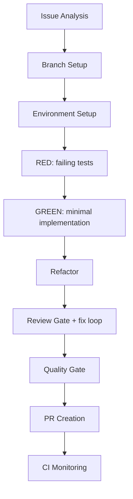

# Issue to PR Workflow Guide

> Auto-generated by spec-workflow-init, then specialized for this repository.
> Generated: 2026-11-17

## Workflow Overview



## Development Environment

| Item | Value |
|---|---|
| Language / Framework | Python 3.11+ (runtime 3.14) core; TypeScript workspaces (React dashboard, Ink TUI, Electron desktop) |
| Package Manager | `pnpm` (JS workspaces); PM — `hermes pm` over uv (Python) |
| Container | `Dockerfile` + `docker-compose.yml` exist; **workflow commands run on the host** |
| Database | None declared (SQLite session state via `hermes_state`; no Prisma/migrations) |
| Test Framework | pytest via `scripts/run_tests.sh`; vitest per JS workspace; Playwright for desktop E2E |
| CI/CD | GitHub Actions (`.github/workflows/`) |
| Branch Strategy | GitHub Flow — `main` only, short-lived branches |
| Branch Naming | `{type}/{issue}-{slug}` (e.g. `feat/42-add-auth`) |
| PR Target | `main` |
| Development Style | TDD — RED → GREEN → refactor → review → gate → PR |
| Coding Rules | `docs/coding-rules.md` |
| Review Rules | `docs/review_rules.md` |

## 1. Issue Analysis and Setup

```bash
gh issue view {issue_number}
```

Identify acceptance criteria, technical constraints, and related issues/PRs.

### Check Specifications

```bash
ls .specs/{project_name}/
cat .specs/{project_name}/requirement.md
cat .specs/{project_name}/design.md
cat .specs/{project_name}/tasks.md
cat .specs/{project_name}/test.md
```

### Read the Area Rules

Every directory carries its own `AGENTS.md` that loads when you work there. Before
touching code, read the one for the area (`gateway/`, `tools/`, `hermes_cli/`,
`tests/`, `pm/`, `web/`, ...). Never grep for `AGENTS.md` files — they are already in
context where they apply.

### Create Feature Branch

```bash
git checkout main
git pull origin main
git checkout -b feat/{issue}-{slug}
```

Prefix follows the change type (`feat/`, `fix/`, `refactor/`, `docs/`, `test/`,
`chore/`) — the same vocabulary as the commit type.

## 2. Environment Setup

```bash
# PM environment (provisions the pinned toolchain)
source ./activate          # bash/fish; PowerShell: . ./activate.ps1

# JS workspaces (frozen lockfile; the preinstall guard enforces the pinned pnpm)
pnpm install --frozen-lockfile

# Fresh test interpreter (not an in-place sync; the output must not exist)
python -m pm.build_env --source . --out .venv --group dev --group test

# Sanity check: the canonical lint lane
python scripts/check --only health
```

- Never mutate a Hermes environment with raw `pip` or `uv` — use `hermes pm install`
  / `pm.sync_venv` (`pm/AGENTS.md`).
- Dependency changes: edit `pyproject.toml`, run `hermes pm lock`, re-source
  `./activate`, and commit `uv.lock` with it.
- `~/.hermes/.env` is secrets only; behaviour goes in `config.yaml`.

## 3. Phased Implementation

### Phase 1: Analysis and Design

- Read the issue, the spec set, and the `AGENTS.md` of every touched area.
- Identify the affected facade/sibling pair, the toolsets or routers involved, and the
  tests that already cover the path.
- Write down the invariant the change protects (this becomes the test name).

### Phase 2: Test Implementation (RED)

Write the failing test first. It must **fail on the base revision** before the
implementation exists — that is the proof the test is load-bearing.

```bash
scripts/run_tests.sh tests/<area>/test_<topic>.py -k test_<name>
```

Repo-specific test rules (`tests/AGENTS.md`, `docs/coding-rules.md` § Testing):

- `scripts/run_tests.sh` only — never bare `pytest`.
- Placement mirrors the source tree; no issue numbers in filenames.
- No network, no `~/.hermes/` writes; use fixtures.
- Host-differential behaviour: one `@pytest.mark.platforms(...)` marker, tested on
  that host. Never patch `sys.platform`.
- No change-detector tests, no tests that read source text.
- Timing: wall-clock bounds ≥ 2 s, event-based sync, no new non-zero sleeps.

### Phase 3: Core Implementation (GREEN)

Write the minimum code that makes the tests pass, following
`docs/coding-rules.md`:

- New behaviour goes in a topical sibling (`<stem>_<topic>.py`), never a facade.
- Complexity ≤ 20, function ≤ 300 lines, nesting ≤ 6, file ≤ 2,000 lines.
- `get_hermes_home()` instead of `~/.hermes`; profile scope bound explicitly outside a
  turn; identity from structure, not argv substrings.
- Fail loud at integration boundaries — no silent defaults outside documented product
  choices.

### Phase 4: Refactoring

Refactor with tests green. Remove dead weight; no defensive `try/except: pass`; no
wrapper that exists only to be renamed later.

```bash
scripts/run_tests.sh tests/<area>/
```

### Phase 5: Code + Test Review Gate

Review implementation and test code together against `docs/review_rules.md`.

#### Review Criteria

- Severity and `fix_before` classification per `docs/review_rules.md` §7.
- `[MUST]` violations from `docs/coding-rules.md`.
- Skip files excluded by `docs/review_rules.md` §6 (generated, vendored, lockfiles).
- Verify the change matches the issue's acceptance criteria.

#### Review Result Actions

Severity is for human priority; the gate acts on each finding's `fix_before` tag
(`implementation | trial | required_check | follow_up`, default `follow_up`).

| Finding | Action on Detection |
|---|---|
| `fix_before: implementation` | Fix immediately → re-review |
| `fix_before: trial` / `required_check` / `follow_up` | Record; carry to the PR body / a follow-up issue |
| Minor (style) | Log only, may continue |

#### Fix Loop (max 3 iterations)

1. Detect issues in review.
2. Fix the `fix_before: implementation` findings.
3. Re-review only the fixed areas.
4. Repeat (up to 3 times).
5. After the 3rd iteration, unresolved `fix_before: implementation` findings → ask the
   user to decide (continue or stop).
6. Review passes → proceed.

#### Second Opinion

Dispatch a fresh reviewer with no prior context (bundled `reviewer` agent), or delegate
to another vendor with `agent-delegate --mode review --target <peer>` when that CLI is
installed. The second opinion is a new review, not a new runtime.

### Phase 6: Quality Gate

All of these must pass before a PR exists:

```bash
python scripts/check                 # ruff + workflow guards + code-health ratchet
pnpm -r --if-present run typecheck   # TS only; no Python typechecker is configured
pnpm -r --if-present run build       # only the workspaces that define a build
scripts/run_tests.sh                 # full pytest suite
pnpm -r --if-present run test        # vitest per JS workspace
```

`python scripts/check` is the same command CI's lint lane runs. Install it as a
pre-push hook with `python scripts/check --install-hook pre-push`; re-run that after
pulling. A `# noqa` does not waive a code-health finding; `# health: allow <RULE> -- <why>`
does.

## 4. Testing

### API / CLI Integration

```bash
scripts/run_tests.sh tests/gateway/ tests/hermes_cli/
```

Verify:
- Gateway adapters and RPC surfaces handle expected and error inputs.
- CLI commands and slash dispatch keep their contracts.
- Auth paths use the single session-token scheme.

### Browser E2E

```bash
pnpm --filter hermes run test:e2e
```

Critical paths:
- Desktop app launch and `serve` backend handshake.
- Primary user journey for the changed surface.
- Form submissions, validation, and error states.
- Navigation and routing.

### Live Windows Process Topology

When the claim is about real Windows process behaviour that mocks cannot reproduce
(venv-holder scans, launcher/worker chains, detach semantics), use the `wine2e` lane:
push probes to a `wine2e/**` branch, reproduce on unfixed code, iterate until the lane is
green, then open the PR. The live run on the exact head is the proof reviewers ask for.

### Platform Claims

Only claim a platform you actually ran. Host-specific behaviour is tested on that host
with `@pytest.mark.platforms(...)`; a bare `skipif(sys.platform ...)` runs nowhere.

## 5. PR Creation and Quality Gates

### Pre-PR Checklist

- [ ] Tests pass: `scripts/run_tests.sh` + `pnpm -r --if-present run test`
- [ ] Lint passes: `python scripts/check`
- [ ] Typecheck passes: `pnpm -r --if-present run typecheck`
- [ ] Build succeeds for touched JS workspaces: `pnpm -r --if-present run build`
- [ ] Browser E2E passes when UI changed: `pnpm --filter hermes run test:e2e`
- [ ] Docs updated (`AGENTS.md`, `website/docs/`, `docs/`) — a docs omission is a
      Critical review finding
- [ ] Branch rebased onto `main`

### Create PR

```bash
gh pr create --base main --title "feat({scope}): {description} (closes #{issue_number})" --body "## Summary
- {summary_points}

## Test Plan
- [ ] Unit/integration tests added or updated (`scripts/run_tests.sh ...`)
- [ ] Browser E2E verified (if UI changed)
- [ ] `python scripts/check` green
- [ ] Platforms tested: {platforms}

## Related
- Closes #{issue_number}
- Spec: .specs/{project_name}/
"
```

Conventional Commits: `<type>(<scope>): <description>` — types `fix`, `feat`, `docs`,
`test`, `refactor`, `chore`; scopes `cli`, `gateway`, `tools`, `skills`, `agent`,
`install`, `security`, ... Rebase onto `main` before merging; a squash from a stale
branch silently reverts newer fixes.

## 6. CI/CD Monitoring

```bash
gh run list --limit 5
gh run watch
```

### Error Recovery

1. Check the failed step:
   ```bash
   gh run view {run_id} --log-failed
   ```
2. Classify before fixing:
   - A Python test asserting about `package.json` / `.tsx` sources will not run on a
     JS-only PR (green on PR, red on `main`) — move it to the vitest suite.
   - An OS lane failure means the marker or the host-specific code is wrong, not that
     the runner is flaky.
   - A passing-on-retry test prints `⚠ FLAKY` — treat it as a bug, not noise.
3. Fix locally, verify with `python scripts/check` and the narrowest test that exercises
   the change, then push:
   ```bash
   git add -A && git commit -m "fix({scope}): resolve CI failure" && git push
   ```
4. Monitor again.

## Agent Roles

### Multi-Agent Role Assignment Strategy

| Phase | Implementer | Tester | Reviewer |
|---|---|---|---|
| Analysis | Design review | Test plan | - |
| Implementation | Write code | Write tests | - |
| Review | - | - | Review code + tests |
| Quality Gate | - | Run all tests | Final check |

### Role Assignment

| Role | Agent | Responsibility |
|---|---|---|
| Planner | `workflow-planner` | Generate requirement.md / design.md / tasks.md / test.md |
| Implementer | `workflow-implementer` | Write production code per `docs/coding-rules.md` |
| Reviewer | `workflow-reviewer` | Review against `docs/review_rules.md` |
| Tester | `workflow-tester` | Write and run tests, verify contracts |
| Evaluator | `workflow-evaluator` | Run `test.md` acceptance cases, save evidence |

### Agent definition files

- `.omp/agents/workflow-planner.md` — planning agent
- `.omp/agents/workflow-implementer.md` — implementation agent
- `.omp/agents/workflow-reviewer.md` — review agent
- `.omp/agents/workflow-tester.md` — test agent
- `.omp/agents/workflow-evaluator.md` — acceptance evaluation agent

### Dispatch with the omp `task` tool

Spawn one `tasks[]` batch per parallel wave. Each item names the role agent and carries
only task-specific context:

```json
{
  "context": "Project rules: docs/coding-rules.md, docs/review_rules.md, workflow: docs/issue-to-pr-workflow.md. Issue #42.",
  "tasks": [
    {"agent": "workflow-implementer", "task": "Implement T-1 per design.md.", "solutionSpace": "one fix: implementation given design"},
    {"agent": "workflow-tester", "task": "Write tests for T-1.", "solutionSpace": "one fix: tests given design"}
  ]
}
```

- **Agent names**: use the `Agent` column value. omp rediscovers `.omp/agents/` before
  each spawn, so a newly generated definition is usable immediately — no restart.
- **Fallback**: when the `workflow-*` definitions are absent, dispatch the bundled
  `worker` for implementation/evaluation runs and `reviewer` for review.
- **Lead agent duties**: keep the review gate, the fix loop, and PR creation/merge in
  the lead agent. Sub-agents report back and stop.
- **Worktree discipline**: parallel agents editing the same file need one integration
  owner; give each task its own files.
- **Turn discipline**: see below.

## Turn Discipline (multi-agent runs)

`.omp/hooks/pre/pipeline-watchdog.ts` refuses a main-session stop while this run is
mid-flight and no wait is registered: you get one continuation with the next action
spelled out. It is a safety net, not the loop.

- Do not end a turn while a spec-orchestrate run is active — `.paused` in
  `.specs/.orchestrate-active.json` is not `true` and
  `.specs/{project_name}/pipeline-state.json` has not completed `retrospective` — unless
  you have either (a) dispatched the next phase as a `task` batch, or (b) registered a
  wait (`waiting_report` in the run marker) that resumes you when it finishes. A bare
  in-turn polling loop dies with the turn.
- `session_stop` never fires for `task`/subagent sessions. A role agent must report its
  result in its own turn; the hook cannot nudge it.
- After every resume, re-read the state before acting:

  ```bash
  jq -r '.phase' .specs/{project_name}/pipeline-state.json
  jq -r '.paused // false' .specs/.orchestrate-active.json
  ```

- Then cross-check that state against on-disk evidence and reconcile before dispatching:

  ```bash
  bash <spec-orchestrate skill dir>/references/scripts/pipeline-state-check.sh .specs/{project_name}
  ```

  Exit 1 means drift: reconcile `pipeline-state.json` to the evidence first. Never
  dispatch the next phase on a stale state.
- If the user pauses the run (`paused: true`) or `retrospective` is complete, stop
  normally.

---

> This workflow was generated by spec-workflow-init. Customize it to match your
> project's evolving needs.
