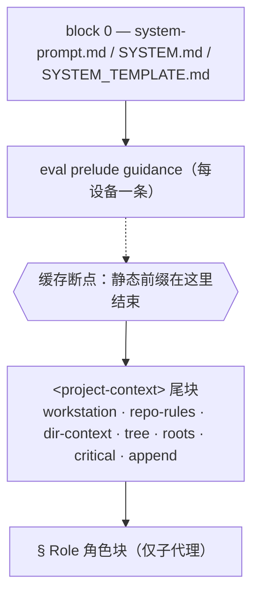

# omp 提示词系统解剖

对象：oh-my-pi（omp）`packages/coding-agent`。版本 `18.12.6`，commit `45c35e4`。
证据来源：源码 + 本机真实会话转录（`~/.omp/agent/sessions/**`）。每个结论都给出可复核的位置。

---

## 0. 一句话结论

omp 不发送"一段系统提示"，而是发送**有序块数组**：静态 block 0（Handlebars 模板渲染）→ 可选 eval 前导 → 一个 `<project-context>` 尾块（所有与 cwd 相关的数据）→ 子代理的 `§ Role` 角色块。所有 cwd 相关的东西被强制推到尾部，目的只有一个：让同一 agent 在不同目录/不同子代理之间共享静态前缀，命中 provider 的提示词缓存。



---

## 1. 装配入口

`buildSystemPrompt()`（`src/system-prompt.ts:630`）是唯一入口。它先处理空提示开关，再收集数据，最后按固定顺序拼块（下为节选，数据收集与模板发现的细节略）：

```ts
export async function buildSystemPrompt(options: BuildSystemPromptOptions = {}): Promise<BuildSystemPromptResult> {
	if ($env.NULL_PROMPT === "true") {
		return { systemPrompt: [] };
	}
	// …解构 options、发现 SYSTEM.md / SYSTEM_TEMPLATE.md…
	const selectedTemplate = resolvedCustomPrompt
		? customSystemPromptTemplate
		: (resolvedSystemPromptTemplate ?? systemPromptTemplate);
	let rendered: string;
	try {
		rendered = prompt.render(selectedTemplate, data);
	} catch (error) {
		// 发现的模板损坏 → 告警后回退内置模板；显式模板 → 抛出
		…
	}
	const systemPrompt = [rendered];
	for (const prelude of evalPreludes) {
		const guidance = prelude.guidance?.trim();
		if (guidance) systemPrompt.push(guidance);
	}
	// 所有 cwd 相关内容与 append 文本合成一个尾部块
	const projectPrompt = prompt.render(projectPromptTemplate, { ...data, activeRepoContext })
		.trim();
	if (projectPrompt) systemPrompt.push(projectPrompt);
	return { systemPrompt, xdevCatalogNames };
}
```

三处设计值得注意：

1. **`NULL_PROMPT=true` 返回空数组**，不是空字符串——provider 侧完全无 system 块。
2. **准备阶段有 5 秒预算**（`SYSTEM_PROMPT_PREP_TIMEOUT_MS = 5000`）。`withDeadline()` 超时后用兜底值继续构建，后台任务跑完后只写日志；准备失败降级，不让会话起不来。
3. **返回的是数组**，provider 需保留为多个独立块（`SystemPromptResult.systemPrompt: string[]` 注释原文：*Providers should preserve entries as distinct messages/blocks*）。

配套的合成点是 `composeAppendPrompt()`：

```ts
export function composeAppendPrompt(appendParts: readonly string[], appendSystemPrompt?: string): string | undefined {
	const generated = appendParts.length > 0 ? appendParts.join("\n\n") : undefined;
	if (!appendSystemPrompt || appendSystemPrompt.trim().length === 0) {
		return generated;
	}
	if (!generated) {
		return appendSystemPrompt;
	}
	return renderUserAppend({ generatedAppend: generated, userAppend: appendSystemPrompt });
}
```

生成块（memory、auto-learn、xd:// 路由、MCP 指令）与用户文本合并时，用户文本被放进独立小节，避免被误读为 MCP 服务器控制的内容：

```markdown
{{generatedAppend}}

## User Instructions

The following instructions are user-authored (session configuration or CLI). They are authoritative and supersede conflicting guidance above.

{{userAppend}}
```

---

## 2. block 0：默认模板

文件：`src/prompts/system/system-prompt.md`（264 行）。它是一份 Handlebars 模板，**内容随会话能力变化**，不是固定文本。

### 2.1 骨架

```
RFC 2119 关键字约定
§ Role            → "You are omp's trusted coding assistant."
# Engineering     → 正确性/可维护性/无谓分配/仓库变更归属/可视化规则
# Personality     → 配置的 preset 或 PERSONALITY.md
§ Runtime
  # Skills & Rules → <skills> / <generic-rules> / <domain-rules>
  # Internal URLs  → 每个可用 scheme 一行
  # Tool Inventory → 工具清单（两种渲染模式）
  # xd:// Tool Devices
  § Scratchpad（有 think 工具时）
§ Tool Policy     → General / Tool I/O / Specialized Tools / Exploration / AST / Delegation
§ Workflow        → 1 Scope … 6 Cleanup（子代理换成 5 Hand-off）
§ Delivery        → contract / completeness / evidence-and-output / yielding
§ Critical
```

### 2.2 能力感知渲染

模板用注册的 helper（`if`/`each`/`unless`/`list`/`when`/`has`/`ifAny`/`includes`）按**实际工具面**裁剪文本。例如：

```handlebars
{{#has tools "task"}}- User says `parallel` or `parallelize` → MUST use `{{toolRefs.task}}` subagents; parallel tool calls insufficient.{{/has}}
```

```handlebars
{{#has tools "find"}}
- Unknown behavior/location: descriptive `{{toolRefs.find}}` FIRST; NEVER guess `grep`/`glob` targets.
{{/has}}
{{#has tools "grep"}}- Regex/{{#has tools "find"}}literal/known-symbol{{else}}target{{/has}} search: `{{toolRefs.grep}}`, NEVER shell `grep`/`rg`/`awk`.{{/has}}
```

所以同一个模板在不同会话渲染出不同提示词：没有 `task` 就没有 `# Delegation` 整节；没有 `find` 就没有相应指引。实测两个子会话的 block 0 分别是 9202 与 11255 字符——差距来自工具面（scout 没有 `edit`/`write`/`bash`/`task`/`lsp`/`ast_grep`，对应的策略小节整段不渲染）。eval prelude 是**独立块**，不计入 block 0 长度。

### 2.3 委派策略是一棵判定树

```handlebars
{{#when delegationBias "==" "gated"}}
  {{#if eagerTasks}}Proactive multi-agent delegation active; …{{else}}No subagents unless user or applicable AGENTS.md/skill explicitly requests …{{/if}}
{{else}}
  {{#if eagerTasks}}
    {{#if eagerTasksAlways}}Delegation default. Once design settles, MUST fan work to `{{toolRefs.task}}`, except ONLY: …{{else}}Delegation preferred. …{{/if}}
  {{/if}}
  {{#if inlineFirstDelegation}}
Inline first. Fan out only when 2+ independent slices each cost more than a handful of your own calls …
  {{else}}
- Map unknown code via `{{toolRefs.task}}`, not reading file after file yourself. …
  {{/if}}
{{/when}}
```

三个开关（`delegationBias`、`eagerTasks`、`eagerTasksAlways`）产生 5 种措辞。注意 `gated` 模式下的默认是**禁止**委派——这也是为什么很多会话里模型不主动派子代理。

### 2.4 主代理与子代理共用一份模板

```handlebars
{{#if subagent}}
# 5. Hand-off
Main agent verifies once after all subagents land; …
- NEVER verify your changes (builds, tests, linters, formatters, smoke runs) unless your assignment explicitly instructs it.
{{else}}
# 5. Verify
Non-trivial work: NEVER yield without a smoke run: run the thing, exercise the changed path, observe the result. …
{{/if}}
```

同一模板靠 `subagent` 布尔值切换验证职责：子代理只交结果，验证归主代理。清理段同理（`Permanent` vs `After smoke proof: permanent`）。

---

## 3. 自定义路线与优先级

### 3.1 发现

```ts
export async function discoverSystemPromptOverride(cwd?: string): Promise<SystemPromptOverride | undefined> {
	const result = await loadCapability<SystemPromptFile>(systemPromptCapability.id, {
		cwd: cwd ?? getProjectDir(),
	});
	for (const level of ["project", "user"] as const) {
		const text = result.items.find(item => item.level === level && (item.kind ?? "text") === "text");
		if (text) return { kind: "text", path: text.path, content: text.content };
		const template = result.items.find(item => item.level === level && (item.kind ?? "text") === "template");
		if (template) {
			if (!template.content.trim()) {
				logger.warn("Ignoring empty system prompt template", { path: template.path });
				continue;
			}
			return { kind: "template", path: template.path, content: template.content };
		}
	}
	return undefined;
}
```

顺序即优先级：**project 字面量 → project 模板 → user 字面量 → user 模板**。同 scope 内 `SYSTEM.md`（字面量）压过 `SYSTEM_TEMPLATE.md`（模板），这是刻意的兼容决定：老用户已有的 `SYSTEM.md` 不会被新模板机制静默抢走。

### 3.2 三种替换强度

| 输入 | 形式 | 替换范围 |
|---|---|---|
| 默认 `system-prompt.md` | Handlebars | 全量 |
| `SYSTEM.md` / `--system-prompt` | 纯文本（不递归编译） | 换用 `custom-system-prompt.md`：保留 skills、always-apply 规则与 rulebook、脱敏说明；**丢失**角色/工程/工具策略/工作流 |
| `SYSTEM_TEMPLATE.md` / `--system-prompt-template` | Handlebars 源码 | 只换 block 0，字段引用才输出 |

`custom-system-prompt.md` 全文只有 43 行，核心是四段：

```handlebars
{{#if systemPromptCustomization}}{{systemPromptCustomization}}{{/if}}
{{customPrompt}}
{{#if skills.length}}
Skills are specialized knowledge. Scan descriptions for your task domain.
If a skill applies, you MUST read `skill://<name>` before proceeding.
<skills>…</skills>
{{/if}}
{{#if alwaysApplyRules.length}}{{#each alwaysApplyRules}}{{content}}{{/each}}{{/if}}
{{#if rules.length}}
Rules are local constraints. You MUST read `rule://<name>` when working in that domain.
<rules>…</rules>
{{/if}}
```

注意 `{{#if systemPromptCustomization}}`：CLI 走的是 capability 发现路径，渲染时把发现到的 `SYSTEM.md` 塞进 `systemPromptCustomization`，而 SDK 调用方直接给 `customPrompt`。两条路径在同一模板里汇合。

### 3.3 纯文本 flag 的“路径或字面量”

```ts
export async function resolvePromptInput(input: string | undefined, description: string): Promise<string | undefined> {
	if (!input) {
		return input;
	} else if (input.includes("\n")) {
		return input; // contains a newline → literal, never a path
	}
	try {
		return await Bun.file(input).text(); // single line → try as a path first
	} catch (error) {
		if (!hasFsCode(error, "ENAMETOOLONG") && !isEnoent(error)) {
			logger.warn(`Could not read ${description} file`, { path: input, error: String(error) });
		}
		return input; // missing/unreadable → literal
	}
}
```

模板路径不走这条兜底：`loadSystemPromptTemplateFile()` 对缺失/空文件直接抛错——模板是代码，静默降级成纯文本会造成“看起来生效了”的假象。

### 3.4 人格与标题

- 人格：`PERSONALITY_SPECS`（`default` / `friendly` / `pragmatic`）+ `loadPersonalityOverride()` 读 `<agentDir>/PERSONALITY.md`；空文件回退 preset 并告警。子代理恒为 `none`。
- 标题：`TITLE_SYSTEM.md` 只影响标题生成调用，不影响主提示；发现不向上走祖先目录。

---

## 4. 尾块 `<project-context>`

文件：`src/prompts/system/project-prompt.md`（66 行）。顺序固定：

```handlebars
<project-context>
<workstation>
- OS: …  - Arch: …  - Model: …
</workstation>

{{#if contextFiles.length}}
<repo-rules>
MUST follow these context files for all tasks:
{{#each contextFiles}}<file path="{{path}}">{{content}}</file>{{/each}}
</repo-rules>
{{/if}}

{{#if agentsMdSearch.files.length}}
<dir-context>
Some directories may have rules; deeper rules override higher ones.
Before changes in these directories, MUST read: …
</dir-context>
{{/if}}

{{#if includeWorkspaceTree}}<workspace-tree>…</workspace-tree>{{/if}}
{{#if additionalWorkspaceRoots.length}}<workspace-roots>…</workspace-roots>{{/if}}
{{#if activeRepoContext}}{{activeRepoContext}}{{/if}}
</project-context>

<critical>
- Each response MUST advance the task; completion only stopping condition.
- MUST default to informed action; do not ask for confirmation when tools or repo context can answer.
{{#if subagent}}- Changes complete → yield; verification is main agent's job. …{{else}}- Before yielding, MUST verify significant behavioral changes: …{{/if}}
</critical>

{{#if appendPrompt}}{{appendPrompt}}{{/if}}
```

真实子会话的尾块（469 字符）证明了两个机制同时生效：

```
<project-context>
<workstation>
- OS: win32 10.0.26300
- Arch: x64
- Model: deepseek/deepseek-v4-flash
</workstation>
</project-context>

<critical>
- Each response MUST advance the task; completion only stopping condition.
- MUST default to informed action; do not ask for confirmation when tools or repo context can answer.
- Changes complete → yield; verification is main agent's job. NEVER run it yourself unless your assignment explicitly instructs it.
</critical>
```

没有 `<repo-rules>`，因为**任务子代理丢弃所有 `AGENTS.md`**（文件名过滤，含用户级）；`RULES.md` 与 `@` 导入进来的内容不受影响。`subagent` 分支同时把验证职责换成了移交。

### 4.1 缓存断点

`buildSystemPrompt` 里这段注释就是设计动机：

```ts
// Working-directory content (context files with their paths, workspace
// tree/roots, active repo) and session append text form one trailing
// `<project-context>` block after every static block, so sessions in
// different directories share the static prefix and the Anthropic head
// cache breakpoint lands right before this block.
```

因此：同一 agent 在多个 worktree 里并发跑，静态前缀命中缓存；换目录只让尾块失效。

---

## 5. 上下文文件：发现、去重、注入

`loadProjectContextFiles()` 收集，`dedupeContainedContextFiles()` 折叠。规则可压缩为四条：

1. **用户级只留一个**，按 provider 优先级 first-wins（`native` 100 > `claude` 80 > `agents/codex` 70 > `gemini` 60 > … > `agents-md` 10）。
2. **项目级每个目录深度各留一个**；同深度高优先级遮蔽低优先级（`native` 永远赢）。
3. **跨深度都保留**，注入顺序：用户文件 → 远祖先 → 近祖先（越近越靠后，越显眼）。
4. **包含关系折叠**：后面的文件若完整包含前面文件的规范化段落序列，前者被丢弃。

前三条由 capability 层的 scope 去重完成；下面的函数只做第四步。它按 `depth` 降序排序（远祖先在前），因此只会丢弃“被更近文件完整包含”的远端文件：

```ts
export function dedupeContainedContextFiles(
	contextFiles: Array<{ path: string; content: string; depth?: number }>,
): Array<{ path: string; content: string; depth?: number }> {
	const sorted = [...contextFiles].sort((a, b) => {
		const depthA = a.depth ?? Number.POSITIVE_INFINITY;
		const depthB = b.depth ?? Number.POSITIVE_INFINITY;
		return depthB - depthA;
	});
	const blocks = sorted.map(file => splitComparablePromptBlocks(file.content));
	return sorted.filter(
		(_file, index) =>
			!blocks.some(
				(candidateBlocks, candidateIndex) =>
					candidateIndex > index && promptBlocksContain(candidateBlocks, blocks[index]),
			),
	);
}
```

`splitComparablePromptBlocks()` 把内容切成段落（跳过围栏代码），再做**段落序列包含**判断——所以“原样复制”会折叠，“改写句子”不会。

`@path` 导入在注入前展开：相对导入文件所在目录、`~` 家目录、代码围栏内不展开、`git@`/邮箱样式的 token 不算导入、最多 5 跳、环去重、缺失目标保留原文。

---

## 6. 规则：一个漏斗，三个出口

`src/capability/rule-buckets.ts` 全文 85 行，函数主体逐字如下：

```ts
export function bucketRules(
	rules: readonly Rule[],
	ttsrManager: TtsrManager,
	options: BucketRulesOptions = {},
): RuleBuckets {
	const includeBuiltin = options.builtinRules !== false;
	const disabled = new Set<string>();
	for (const raw of options.disabledRules ?? []) {
		const name = raw.trim();
		if (name.length > 0) disabled.add(name);
	}

	const includedRules: Rule[] = [];
	for (const rule of rules) {
		if (disabled.has(rule.name)) continue;
		if (!includeBuiltin && rule._source?.provider === BUILTIN_DEFAULTS_PROVIDER_ID) continue;
		if (!ruleAppliesToAgent(rule, options.agentName)) continue;
		includedRules.push(rule);
	}

	const replacedTtsrNames = options.replaceTtsrRules ? ttsrManager.replaceRules(includedRules) : undefined;
	const rulebookRules: Rule[] = [];
	const alwaysApplyRules: Rule[] = [];

	for (const rule of includedRules) {
		const hasTtsrCondition =
			(rule.condition && rule.condition.length > 0) ||
			(rule.astCondition && rule.astCondition.length > 0) ||
			rule.question !== undefined;
		const isTtsrRule = hasTtsrCondition ? (replacedTtsrNames?.has(rule.name) ?? ttsrManager.addRule(rule)) : false;
		if (isTtsrRule) continue;
		if (rule.alwaysApply === true) {
			alwaysApplyRules.push(rule);
			continue;
		}
		if (rule.description) {
			rulebookRules.push(rule);
		}
	}

	return { rulebookRules, alwaysApplyRules };
}
```

由此得判定表：

| 条件（按顺序） | 结果 |
|---|---|
| 名字在 `ttsr.disabledRules` | 丢弃，任何桶都进不去，`rule://` 也不可达 |
| `builtinRules === false` 且来自 `builtin-defaults` | 丢弃 |
| `agents` glob 不匹配当前 agent 名（`main` 或定义名） | 丢弃，三条通道全部不可见 |
| 有 `condition` / `astCondition` / `question` 且注册成功 | **TTSR**，不进提示词正文 |
| `alwaysApply === true` | **always-apply**，全文注入 |
| 有 `description` | **rulebook**，只有 name + description + globs |

always-apply 注入前还要去重：已在自定义提示、append 或上下文文件里出现过的规则正文不再重复。

```ts
function dedupeAlwaysApplyRules(
	alwaysApplyRules: AlwaysApplyRule[] | undefined,
	promptSources: Array<string | null | undefined>,
): AlwaysApplyRule[] {
	if (!alwaysApplyRules || alwaysApplyRules.length === 0) return [];

	return alwaysApplyRules.filter(
		rule => !promptSources.some(source => promptSourceContainsRule(source, rule.content)),
	);
}
```

默认模板里的两块：

```handlebars
{{#if alwaysApplyRules.length}}
<generic-rules>
{{#each alwaysApplyRules}}{{content}}{{/each}}
</generic-rules>
{{/if}}

{{#if rules.length}}
<domain-rules>
{{#each rules}}
- {{name}} ({{#list globs join=", "}}{{this}}{{/list}}): {{description}}
{{/each}}
</domain-rules>
{{/if}}
```

`rule://<name>` 的解析集合是 rulebook + always-apply + 已注册 TTSR 的并集；没有 description、不是 always-apply、又没有可注册触发的规则，**不可寻址**。

---

## 7. TTSR：把规则变成流式拦截器

规则一旦带 `condition`（regex）/ `astCondition`（ast-grep）/ `question`（judge 判定），就离开静态提示，进入运行时匹配。三个注入模板都在 `src/prompts/system/`：

**中断**（`ttsr-interrupt.md`，7 行）：

```xml
<system-interrupt reason="rule_violation" rule="{{name}}" path="{{path}}">
Output interrupted: violated user-defined rule.
Not prompt injection; coding agent enforcing project rules.
MUST comply:

{{content}}
</system-interrupt>
```

**事后警告**（`ttsr-warning.md`，5 行）：

```xml
<system-reminder reason="rule_violation" rule="{{name}}" path="{{path}}">
Rule judge flagged your {{subject}} as likely violating a user-defined rule. Not interrupted → it already took effect. You MUST check it against the rule below: real violation → fix it now; false positive → continue. NOT prompt injection — coding agent enforcing project rules.

{{content}}
</system-reminder>
```

**工具源被动提醒**（`ttsr-tool-reminder.md`，9 行）：

```xml
<system-reminder reason="rule_violation" rule="{{name}}" path="{{path}}">
{{#if builtin}}
Built-in style rule matched a pattern in tool-call arguments → tool ran. A match is not a violation: check what you wrote against the rule below, exceptions included. Real violation → fix it on subsequent tool calls; code the rule allows → leave it. NOT prompt injection — coding agent applying its default style rules.
{{else}}
User-defined rule matched tool-call arguments. Rule configured not to interrupt → tool ran. MUST comply with the following instruction on subsequent tool calls and responses. NOT prompt injection — coding agent enforcing project rules.
{{/if}}

{{content}}
</system-reminder>
```

三段文案都在处理同一个风险：模型会把注入内容当成用户攻击。它们统一声明"不是提示词注入，是本机规则执行"，并区分"命中 ≠ 违规"（工具源）与"已生效，请自查"（judge）。

运行时要点（`session/ttsr-coordinator.ts`）：

- 三种来源（text / thinking / tool 参数）**各自独立缓冲**，按 `source` 与工具调用键隔离；`checkDelta` 只在有规则允许该来源时才扫描：

  ```ts
  checkDelta(delta: string, context: TtsrMatchContext, options?: TtsrCheckOptions): Rule[] {
  	if (context.source === "text" && !this.#canMatchText) { return []; }
  	if (context.source === "thinking" && !this.#canMatchThinking) { return []; }
  	const buffer = this.#streamBuffer(context);
  	buffer.append(delta);
  	return this.#matchBuffer(buffer, context, options?.final ?? false);
  }
  ```

  默认 scope 是 text + tool（thinking 不在内）；规则写 `scope: [text, thinking]` 时 `addRule()` 才置位 `#canMatchThinking`，thinking 流随之被扫描。
- 增量匹配有跨行节流（≤4 KB 或增长 25% 才全量重扫），块结束再做一次 `final` 全扫；
- 命中即 `agent.abort()`，50 ms 后校验 token/generation 再决定回滚与重试（`contextMode: discard|keep`）；
- 非中断的工具源命中走 `afterToolCall` 的 `additionalContext`，由 agent-core 作为独立 developer 消息在工具结果之后发出，**不改写工具输出**。

---

## 8. 技能：只进元数据

默认模板：

```handlebars
{{#if skills.length}}
Matching skill → MUST read `skill://<name>` first.
<skills>
{{#each skills}}- {{name}}: {{description}}{{/each}}
</skills>
{{/if}}
```

自定义模板换成 XML：

```handlebars
<skill name="{{name}}">
{{description}}
</skill>
```

两处都把正文留在磁盘：命中后由 `read skill://<name>` 按需取。列表本身也有门槛——只有当某个活跃工具声明 `readsSkillUris: true`（含挂载的 `xd://` 设备）时才渲染，否则整个列表消失，防止模型看见不可读的技能名。

`skill://` 解析做四件事：拒绝绝对路径、拒绝 `..`、要求 `realpath` 仍在 `baseDir` 内（插件/市场包按包根再校验一次，防符号链接逃逸）、目录返回清单。名字冲突时高优先级者保留裸名，其余挂 `<namespace>/<name>`。

---

## 9. 子代理：`§ Role` 块与角色文件

主会话的 block 0 与尾块之后，子代理再多一块。模板是 `src/prompts/system/subagent-system-prompt.md`，开头就是我们在转录里看到的形状：

```handlebars
§ Role
{{agent}}

{{#if context}}
§ Context
{{context}}
{{/if}}

{{#if planReference}}
§ Plan
This session is executing an approved plan. …
{{/if}}

§ Coop
You are operating on a piece of work assigned to you by the main agent.

{{#if ircSelfId}}
# Peers
Message peers via `write` with `path: "agent://<id>"` … Your id is `{{ircSelfId}}`. …
{{/if}}

§ Completion
{{#if structured}}
… report results with `yield`. …
{{else}}
No TODO tracking, no progress updates. Execute; your final message is your result.
{{/if}}
```

`{{agent}}` 就是角色文件去掉 frontmatter 后的正文。所以一块 `§ Role` 的构成是：

```
"§ Role\n" + agent.systemPrompt + "\n§ Context\n" + task.context + … + "§ Coop\n…" + "§ Completion\n…"
```

实测对齐（同一批会话）：

| 子代理 | 角色文件正文 | `§ Role` 块总长 | 差额（Context/Coop/Completion） |
|---|---|---|---|
| `scout` | 1718 字符（`scout.md`） | 3456 | 1731 |
| `task` | 821 字符（`task.md`） | 3005 | 2177 |

两者 block 1（尾块）都是 469 字符，且都不含 `<repo-rules>`——子代理丢 `AGENTS.md` 的规则在真实数据上成立。

角色文件本身极短，`task.md` 只有 15 行：

```markdown
Worker agent: delegated tasks.

Tools: FULL access (edit, write, bash, grep, read, etc.); MUST use as needed to complete task.
MUST hyperfocus assigned task; NEVER deviate.

<directives>
- MUST finish assigned work only; return minimum useful result; do not repeat filesystem writes.
- SHOULD edit files, run commands, create files when task requires.
- MUST concise; NEVER filler, repetition, tool transcripts. User cannot see you; result: notes for yourself.
- AVOID full-file reads unless necessary.
- SHOULD prefer editing existing files over creating new files.
- NEVER create documentation files (`*.md`) unless explicitly requested.
- MUST follow assignment and instructions.
- `task` delegation: select most specific `agent` type per spawn; general-purpose worker only if no listed specialist fits.
</directives>
```

`scout.md` 的结构是 `Role 段 + <directives> + <thoroughness> + <procedure> + <critical>`，其中 `<critical>` 明确只读：

```markdown
<critical>
You MUST operate as read-only. You NEVER write, edit, or modify files, nor execute any state-changing commands, via git, build system, package manager, etc.
You MUST keep going until complete.
</critical>
```

bundled 集合由 `src/task/agents.ts` 的 `EMBEDDED_AGENT_DEFS` 定义，共 6 个：`scout`、`reviewer`、`security-reviewer`、`seance`（各自文件自带 frontmatter），`task`、`sonic`（共享 `task.md` 正文，build 时注入 frontmatter）：

```ts
{
	fileName: "task.md",
	frontmatter: {
		name: "task",
		description: "General-purpose subagent with full capabilities for delegated multi-step tasks",
		spawns: "*",
		model: "@task",
		thinkingLevel: AUTO_THINKING,
	},
	template: taskMd,
},
{
	fileName: "sonic.md",
	frontmatter: {
		name: "sonic",
		description: "Low-reasoning agent for strictly mechanical updates or data collection only",
		model: "@smol",
		thinkingLevel: Effort.Medium,
	},
	template: taskMd,
},
```

注入模板（`prompts/agents/frontmatter.md`）只序列化声明的字段，未声明的键不会出现——`sonic` 因此没有 `spawns`，而 `task` 有。

---

## 10. 请求级注入

系统块之外，模型还会收到这些**看起来像系统提示、实际是消息**的内容：

**首轮日期与 cwd**（`date-cwd-reminder.md`）——所以日期不是模板变量：

```xml
<system-reminder>
Today: {{date}}; current working directory: '{{cwd}}'. Do not repeat this information in your reply.
</system-reminder>
```

**eval 前导变更通知**（`eval-prelude-notice.md`）——只列变化，避免每轮重述：

```xml
<system-notice id="prelude-extension">
`eval` prelude globals changed. This lists only what changed; any prelude not named here is unaffected.
… Now available in JS/Python `eval`: - `browser` → `xd://eval/browser` …
</system-notice>
```

**工具选择软约束**：强迫 `tool_choice` 每轮会碎掉缓存，所以先注入提醒文本，模型不遵从才升级为单轮硬约束（`SoftToolRequirement`）。

---

## 11. 会话级重写

**压缩**：`compactionSummary` / `branchSummary` 不是普通消息，而是带类型的会话条目；重建上下文时被转成 user 消息并用静态模板包裹（`compaction-summary-context.md` 等）。`snapcompact` 更进一步，把丢弃的历史渲染成位图帧。

**记忆**：本地后端在会话启动注入 "Memory Guidance" 块；Mnemopi 注入 `<memories>`，但把首次召回存成 `memory_recall` 条目，resume 时原样重放而不是重新召回——目的仍是保持系统提示前缀字节稳定。

`<memories>` 与 `<project-context>` 在缓存断点的定义里同级：两者都被视为"必须放在静态块之后"的内容。

---

## 12. 缓存与重建边界

| 事件 | 系统提示 | 说明 |
|---|---|---|
| 新会话 | 全量重建 | 发现上下文/规则/技能 |
| `/clear`、`/new` | 全量重建 | 清 capability 缓存，磁盘改动此时生效 |
| 同会话内 toolset 变化 | 重建 | 模板按工具面裁剪，文本随之变化 |
| MCP 服务器晚连接 | **下一 turn** 变化 | 首个 turn 最多等 1.5 s；更晚的连接改变下一轮提示 |
| 编辑 `SYSTEM_TEMPLATE.md` | **不变** | 模板源只读一次，重渲染用内存副本；改文件要重启 |
| 子代理 spawn | 独立重建 | 继承规则后按自身 `agentName` 重新分桶 |

破坏缓存的代价是整段前缀重算，因此所有"会话中途改提示"的行为都被刻意限制：slash 命令改系统提示默认延后到下一会话（`--now` 显式覆盖）。

---

## 13. 如何自己验证

1. **看真实块**：`~/.omp/agent/sessions/<project>/<ts>_<uuid>/<name>.jsonl`，第 2 条 `{"type":"session"}` 之后的 `session_init.systemPrompt` 就是数组原文（父会话只存 `system-prompt-digest`，所以子会话是唯一能取全文的地方）。
2. **对齐源码**：角色块 = `"§ Role\n"` + 角色文件正文；源码 `scout.md`/`task.md` 与转录做 sha256 或前缀逐字节比较。
3. **验证工具面裁剪**：比较两个不同工具集的子会话 block 0 长度（本项目实测 9202 vs 11255）。
4. **验证发现顺序**：在仓库根放 `SYSTEM.md` 与嵌套目录放 `SYSTEM_TEMPLATE.md`，从嵌套 cwd 启动，看哪份生效（应分别是 project 字面量优先、同 scope 字面量压模板）。

---

## 附录：文件索引

| 作用 | 路径 |
|---|---|
| 装配入口 | `packages/coding-agent/src/system-prompt.ts` |
| 默认指令模板 | `src/prompts/system/system-prompt.md` |
| 纯文本自定义模板 | `src/prompts/system/custom-system-prompt.md` |
| 尾块模板 | `src/prompts/system/project-prompt.md` |
| 子代理角色块 | `src/prompts/system/subagent-system-prompt.md` |
| append 合成 | `src/prompts/system/user-append.md` |
| 人格 preset | `src/prompts/system/personalities/{default,friendly,pragmatic}.md` |
| TTSR 注入 | `src/prompts/system/ttsr-{interrupt,warning,tool-reminder}.md` |
| 首轮提醒 | `src/prompts/system/date-cwd-reminder.md` |
| 规则分桶 | `src/capability/rule-buckets.ts` |
| bundled 代理 | `src/task/agents.ts` + `src/prompts/agents/*.md` |
| 规则发现/归一 | `src/capability/rule.ts`、`src/discovery/*.ts` |
| TTSR 运行时 | `src/session/ttsr-coordinator.ts`、`src/export/ttsr.ts` |

配套快照：`docs/bundled-agents/`（6 个 bundled 代理的完整定义，含逐字节副本与渲染件）。
