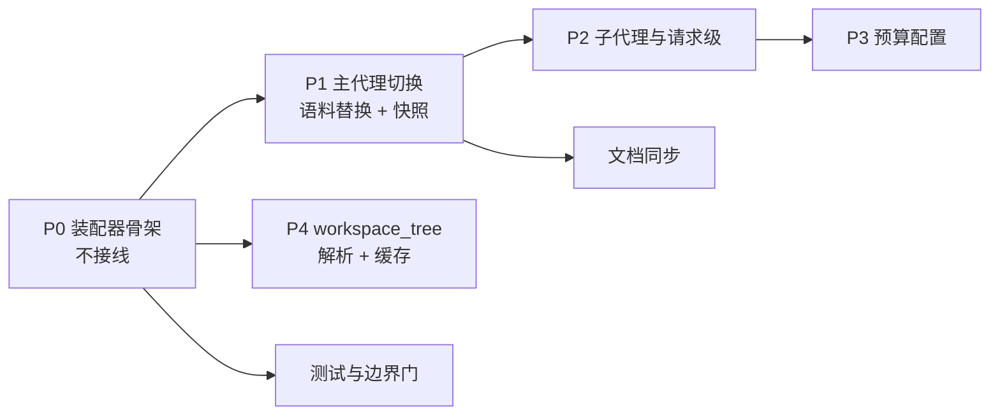

# 提示词装配器分阶段实施计划

对应决策：`docs/adr/ADR-19-prompt-assembler.md`（修订 ADR-18 D1/D2 的落地方式）。
本文件只写**怎么做、按什么顺序、每步如何验收**；设计理由与取舍以 ADR-19 为准。

## 目标与边界

- 新增 `agent/prompts/assembler.py`：唯一装配入口，只装配 `agent/prompts/system/` 下 manifest
  `scope=system` 登记的模板。
- 装配器负责：按代码顺序调 renderer 的块入口、丢弃空块、一次 `join`；每块返回完整正文。
- `renderer.py` 负责：块入口（`render_role` / `render_runtime` / …）的取数与 `render_section`，
  每块返回完整正文。
- `system_prompt.py` 负责：求值 `AssemblyInputs` / `RenderContext`、缓存与持久化。
- 旧正文（`prompt_builder.py` 常量与 `system_prompt.py` 块列表）逐块删除，**不吸收、不并存**。
- 暂缓：override / additionalCommunication（ADR-18 D4）不进入任何阶段。

## 依赖关系

P0 可独立合并；P1 是唯一一次破坏性切换；P2/P3/P4 互不阻塞（P4 也可先于 P1 合并）。

---

## P0 — 装配器骨架（零接线）

**装配器契约**（P0 即生效）：

- `assemble_main(ctx) -> str`：按**代码顺序**调用 renderer 的块入口——`render_rfc2119()`、
  `render_role()`、`render_runtime()`、`render_tool_policy()`、`render_memories()`、
  `render_closing()`、`render_project_context()`——每块返回**完整正文**，空串丢弃，
  `"\n\n"` join 成**一段正文**。不引入 `PromptTiers`，没有 tier 桶，也不按 manifest 顺序
  逐章二次渲染。
- 块内容与段级开关都在块方法内部：`render_closing` 自行判定 `coding_repo`（非仓库省略
  workflow）、空工具面省略
  tool policy、`skip_context_files` 省略 project context、`memory` gate 在 `render_memories`。
  装配器没有 gate 表；gate 只是 manifest 的登记元数据。
- manifest 只做**模板注册与 `scope`**（`system` / `request`），不驱动装配顺序。
- 装配器只做编排：无读盘、无 `Path` 调用，导入集合仅 `prompt_sections` / `renderer` / stdlib。

**目标**：装配能力就位，生产字节不变（`system_prompt.py` 仍走旧路径）。

### 任务

- [x] `prompt_sections.py`
  - 解析 manifest `scope`（`system` / `request`），缺省 `system`；白名单与非法值校验。
  - gate 白名单与 `truncate` 校验保持不变（gate 仍登记在 manifest）。
- [x] `system/manifest.json`
  - 给 9 个请求级模板标 `scope: request`：`eager_task`、`eager_todo`、`irc_incoming`、
    `subagent_role`、`subagent_system_prompt`、`subagent_user_prompt`、`subagent_async_pending`、
    `subagent_completion_probe`、`subagent_yield_reminder`。
  - 删除 `additional_communication` 条目（无模板、无 renderer，暂缓）。
  - 其余章节为 `scope: system`。
- [x] `assembler.py`
  - `AssemblyInputs`（`tools` / `subagent` / `memory`）、`RenderContext`、
    `SessionFacts`、`SubagentRole`。**没有 `PromptTiers`**。
  - `assemble_main(ctx) -> str`：按代码顺序调块入口，丢弃空串，`"\n\n"` join。
  - `assemble_subagent(ctx, role)`：`assemble_main(ctx)` + `"\n\n"` + 角色块（P2 才接线）。
- [x] `renderer.py`
  - 补齐块入口：`render_role`（01–03）、`render_runtime`（04/06–08）、`render_tool_policy`（09）、
    `render_memories`（05）、`render_closing`（10–12）、`render_project_context`（尾块）。
  - 块方法只从入参取数，**不得**接收或反查 `AIAgent`；缺字段先补 `SessionFacts`。
- [x] 测试
  - `tests/agent/test_prompt_assembler.py`：块调用顺序 == 代码顺序、每块恰好一次、空块丢弃、
    facts 透传。
  - `tests/agent/test_prompt_assembler_boundary.py`：AST 导入白名单（`prompt_sections` /
    `renderer` / stdlib），禁止 `system_prompt` / `prompt_builder` / `run_agent` / `hermes_cli`；
    装配器源码无 `open` / `read_text` / `Path`。
  - `tests/agent/test_prompt_sections.py` 扩展：`scope` 解析与非法值；`additional_communication`
    不存在。

### 验收

- `scripts/run_tests.sh tests/agent/test_prompt_assembler.py tests/agent/test_prompt_assembler_boundary.py tests/agent/test_prompt_sections.py`
- `scripts/run_tests.sh tests/ci/test_prompt_surface.py`：9 个 surface **逐字节不变**（P0 不接线）。
- `python scripts/check`

> 状态（2026-11-12）：单元/边界/`scope` 测试与 `test_project_context`、`test_system_prompt*`、
> `test_prompt_live_wiring` 全绿。surface 验收：用同一 POSIX 解释器分别渲染 `HEAD` worktree 与
> 工作树，9 个 surface + tool schema **逐字节相同**，证明 P0 零字节影响；committed snapshot
> 在 HEAD 上已过期（24 处差异，来自本地领先提交），故 `test_prompt_surface.py` 在 P0 前就是红，
> 快照重建留给 P1。
> `scripts/check` 的默认基线是 merge-base(origin/main)，本机分支领先的既有提交与 `.cache/`
> 打包归档会造成 `health` / `profile-archives` 红；以 `--base HEAD --only health,ruff` 复核，
> 本阶段未提交改动为 **0 blocking / 0 advisory**。

### 回滚

纯新增 + manifest 元数据；revert 即可，无字节影响。

---

## P1 — 主代理切换（语料替换）

**目标**：`build_system_prompt_parts()` 改由装配器产出；旧正文删除；提示词字节一次性更新。

### 任务

- [x] 模板
  - `system/autoload-skills.md`：登记 manifest，接线（钉住的技能正文）。
  - `system/workspace.md`、`system/plugin-sections.md`、`system/system-message.md`：只建文件，
    **不登记 manifest**。
  - 不创建 `profile.md`、`runtime-state.md`、`environment.md`。
  - `01-identity.md`：模板正文与 `My-H` / `default_role_desc` / `default_role` 默认值保持原样；
    顶部加 profile 名 context（``）；`role` / `role_desc` 为可选覆盖。旧 Hermes
    身份行（`DEFAULT_AGENT_IDENTITY`）在 D5-A 删除，不再注入。
  - `project-prompt.md`：承接原 runtime-environment 信息到 `<workstation>`——本地后端写
    host / home / cwd / scratch 行；remote/sandbox 后端只写后端状态、不写宿主路径；WSL 与
    embedder 文本随同保留。`Model:` 与 `Provider:` 各占一行（供身份改写与漂移校验读取）。
    workspace-tree / roots 保持现状；保持为装配结果的最后一个块（`<project-context>` 起始
    位置之后无其他块）。
- [x] `assembler.py`
  - `SessionFacts` 补 facade 采集的会话事实：`auto_load_skills`（钉住的技能正文）、
    `profile`（profile 名）、`user_profile_enabled`、`delegation_policy`（已解析，含
    `max_concurrency`）。**不补** `platform_hint` / `hermes_help_guidance` / `kanban_guidance`：
    平台提示、自求助与 kanban 判定都由 renderer 自行解析。
  - 新增 `render_autoload_skills` 块：`render_runtime` 之后、`render_tool_policy` 之前，单独
    返回钉住的技能正文。
  - `project_context` 仍是最后一个块；`system_prompt.py` 不再直接调用它。
- [x] `renderer.py`
  - `render_role` 自行解析平台提示（`platforms.load_platform_hints()` + 渲染层需要的
    overlay），不经 `SessionFacts`；`render_tool_policy` 的 delegation 开关来自
    `SessionFacts.delegation_policy`。
  - `render_autoload_skills(ctx)` 只读 `SessionFacts.auto_load_skills`，空串即零字节。
- [x] `system_prompt.py`
  - 构造 `RenderContext`：`AssemblyInputs` 求值（tools、subagent、memory）+ `SessionFacts`
    （platform/model/provider/session/context_length/context_cwd/cwd_is_launch_artifact/
    workspace_roots/toolsets/已渲染的记忆 provider 文本/delegation policy/append_prompt/
    agent_definition/profile/钉住的技能正文）。
  - `build_system_prompt_parts()` 调 `assemble_main()`，签名与 `{stable, context, volatile}`
    返回结构保持不变：`stable` = 装配正文（一段完整文本），`context` = 调用方
    `system_message`，`volatile` = 空串；`_cached_system_prompt_static` /
    `reconstruct_static_prefix()` 语义不变（`stable` 仍是全 prompt 的字面前缀）。
  - 删除块列表与顺序：`_identity_parts`、`_guidance_parts`、`_auto_load_parts`、
    `_coding_parts`、`_post_workspace_parts`、`_context_files_part`、`_skills_prompt`、
    `_memory_parts`、`_plugin_section_blocks`、`_active_profile_line`、`_timestamp_line`
    及其调用点；`_context_files_part` 删除后，context files / 目录规则 / workspace roots /
    append 全部由 `render_project_context(ctx)` 在装配器内完成。
  - `platform_hint()` / `_resolve_platform_hint()` 保留（surface switch 的逐轮提示仍要用），
    只是不再由 `build_system_prompt_parts` 追加。
  - `system_message` 维持现有 context-tier 路径（`system-message.md` 不接线）。
- [x] `prompt_builder.py` 删除 D5-A 常量与 helper：`DEFAULT_AGENT_IDENTITY`、
    `TASK_COMPLETION_GUIDANCE`、`PARALLEL_TOOL_CALL_GUIDANCE`、`TOOL_USE_ENFORCEMENT_GUIDANCE`、
    `GOOGLE_MODEL_OPERATIONAL_GUIDANCE`、`STEER_CHANNEL_NOTE`、`SKILLS_GUIDANCE`、
    `SESSION_SEARCH_GUIDANCE`、`build_memory_guidance`、`KANBAN_GUIDANCE`、
    `HERMES_AGENT_HELP_GUIDANCE*`、`PLATFORM_HINTS`；同步清理 `__all__` 与导入。
- [x] 解析器（D7.3）
  - `_persisted_workspace_block` / `_frozen_workspace_snapshot` / `_seed_workspace_pin`：
    工作区快照不再进入提示，删除或改读 `project-prompt` 的 `<workspace-tree>`。
  - `surface_switch.runtime_host_value` / `identity_line_value`：改锚 `<workstation>`。
  - `conversation_loop._stored_prompt_matches_runtime`：cwd/model 改锚
    `<project-context>` / `<workstation>`。
  - `chat_completion_helpers.rewrite_prompt_model_identity`：model/provider 锚点保持在
    `<workstation>`。
  - `_timestamp_line` 读取方删除。
  - bot-mode protocol 删除后，`Capability epoch:` 的唯一写入点（`_bot_mode_parts` 的
    `epoch_line`）随之消失，而 `_bot_chat_prompt_stale` 对无 stamp 的 prompt 恒判不陈旧：
    Bot Chat 不再因技能/工具/SOUL 能力变化重建。PR 必须二选一并记录——保留 epoch stamp 的
    未接线载体并加测试，或把“能力刷新失效”列为显式接受的行为变更。
- [x] 快照
  - `python scripts/ci/prompt_surface.py render`，提交 9 个 surface 新快照；PR 描述附逐段 diff。
- [x] 文档
  - `website/docs/developer-guide/prompt-assembly.md`：章节化后的顺序、块入口、装配器入口。
  - `docs/prompt-system.md`：与 manifest 的章节/接线状态同步。
  - `agent/prompts/AGENTS.md`、`agent/prompts/system/AGENTS.md`：替换 “assembly entry” 描述，
    补 `scope` 与“块返回完整正文”的规则。

### 验收

- `scripts/run_tests.sh tests/ci/test_prompt_surface.py`（新快照一致）
- `scripts/run_tests.sh tests/agent/test_prompt_assembler.py tests/agent/test_system_prompt.py tests/agent/test_system_prompt_restore.py tests/agent/test_plugin_prompt_sections.py tests/agent/test_platform_hint_desktop.py tests/agent/test_platform_hint_overrides.py tests/agent/test_platform_hint_cron_delivery.py tests/agent/test_platform_hint_telegram_clarify.py`
- 字节所有权：已接线块按代码顺序出现且恰好一次；集合外字节全部映射到 D5-B 的未接线载体。
- `project-prompt.md` 是装配结果的最后一个块（`<project-context>` 起始位置之后无其他装配
  块）；`system_prompt.py` 与 `agent_run.py` 中不存在 `render_project_context` 调用。
- `grep` 不到 D5-A 的常量名；`python scripts/check`。

> 状态（2026-11-13）：P1 已完成。`build_system_prompt_parts()` 只调 `assemble_main()`；
> 装配顺序为 `rfc2119 → role → runtime → autoload_skills → tool_policy → memories →
> closing → project_context`。`stable` = 装配正文、`context` = `system_message`、`volatile` = 空串。
> D5-A 常量已删除（`grep` 归零），`system_prompt.py` 的块列表/工作区冻结/时间行/profile 行一并删除。
> 持久化解析器改锚 `<workstation>`（`Model:` / `Provider:` / `Platform:` / `Current working
> directory:`），旧 `# Hermes runtime environment` / trailer 布局保留只读回退。
> Bot Chat 能力刷新选择**保留 epoch stamp 的未接线载体**：协议段不再进入提示，但 facade 在
> Bot Chat 会话末尾追加 `Capability epoch:`，`stored_prompt_capability_stale()` 语义不变，并有
> `tests/agent/test_system_prompt.py` 真/假用例。
> 9 个 surface 快照已重生成（`scripts/ci/prompt_surface.py render`），并修复了两处快照可移植性：
> Windows 下 JSON 转义路径的 scrub、以及写入强制 LF。`tests/ci/test_prompt_surface.py` 通过。
> `platforms.py` 承接平台提示解析（默认/插件/override/TUI clarifier/cron delivery），
> `system_prompt.platform_hint()` 保留给 surface switch。
> 显式接受的行为变更：`SOUL.md` 不再进入提示（identity 用 `01-identity.md`）；工作区 git 快照与
> `- Worktree:` 隔离提示随 `_coding_parts` 删除（P4 的 `workspace_tree` 只生成目录树，不含 git
> 隔离契约）；`HERMES_AGENT_HELP_GUIDANCE` 的静态 docs 指针只在 `first_input` 判定命中时出现
> （P1 没有 first-input 生产者，留待请求级通道）。`agent.environment_probe` 行移入
> `<workstation>` notes；`agent.coding_instructions` 经 `SessionFacts.append_prompt` 落到
> `project-prompt.md` 尾块；新构建的 prompt 在 session `model_config` 写 `prompt_schema: 2`。
> 技能索引保留 offer-time 门（disabled / platform / environments / requires_apps /
> requires_*），不再只做 platform 过滤。
> 验收：`test_prompt_assembler*`、`test_prompt_sections`、`test_project_context`、
> `test_system_prompt*`、`test_platform_hint_*`、`test_workstation_prompt_parsers`、
> `test_prompt_surface` 全绿；`scripts/check --base HEAD` 仅剩既有的 `profile-archives`
> （`.cache/desktop-inputs` 打包归档）与仓库无关。

### 回滚

单 PR cutover；revert 整个 PR（含快照），不做运行时双栈。

---

## P2 — 子代理与请求级模板

**目标**：子代理提示 = 主代理基础提示 + 角色块；请求级模板统一入口。

### 任务

- [x] `system/subagent-system-prompt.md` 首行 `§ Role` → `§ Subagent Role`。
- [x] `assembler.py`：`assemble_subagent(ctx, role) -> str` = `assemble_main(ctx)` +
      `"\n\n"` + `render_subagent_prompt(role)`；不引入 `PromptTiers`，也不重新分档。
      `role.body` 为空 → `PromptSectionError`。
- [x] `renderer.py`
  - `render_subagent_system_prompt()` 改为 `render_subagent_prompt(role: SubagentRole)`，成为
    `system/subagent-system-prompt.md` 的唯一入口。**不要**叫 `render_subagent_role`：该名字已
    属于请求级 `subagent_role` 模板（`render_subagent_role(*, role: str, ...)`），两者模板不同。
  - `render_request(key, context)` 接管 `scope=request` 模板的渲染。
- [x] `agent/agent_run.py`
  - `_subagent_prompts()` 有定义正文时渲染 `render_subagent_prompt(role)` 作为 `system_message`，
    并把 `role` 挂到 `_subagent_role`；`build_system_prompt_parts` 让 `stable` = base、
    `context` = 角色块（join 后等于 `assemble_subagent`）。异常回退删除；无定义正文的匿名 run
    保留 bare-prompt 契约（`context` 追到用户轮），不构造空角色块。
  - 子代理 `AssemblyInputs` 用子代理自己的工具集求值（`subagent=True`）。
- [x] 测试
  - 子代理输出以 `assemble_main()` 的字节开头、角色块在末尾且恰好一次。
  - 同 `ctx` 的多个子代理 base 前缀完全相同。
  - 全 prompt `§ Role` 恰好一次（identity），`§ Subagent Role` 恰好一次。
  - `subagent` 块级开关矩阵（workflow Hand-off、delivery slice；critical 的 verify/hand-off
    尾块在 `project-prompt.md`，由 `test_project_context` 覆盖）。
  - 请求级模板：`irc_incoming`、`eager_task`、`eager_todo`、yield reminder 走
    `render_request()`，不进入系统提示。

### 验收

- `scripts/run_tests.sh tests/agent/test_prompt_assembler.py tests/agent/test_run_agent.py`
- 子代理 prompt 快照（base 前缀 + 角色块）加入 CI 快照集。

> 状态（2026-11-13）：P2 已完成。`subagent-system-prompt.md` 首行为 `§ Subagent Role`；
> `assemble_subagent()` 追加 `render_subagent_prompt(role)`；`render_request()` 成为
> `scope=request` 的唯一入口并拒绝 `system` 键。`agent_run._subagent_prompts()` 用子代理自己的
> 工具面求值（`subagent=True`）：角色块作为 `system_message`，`_subagent_role` 驱动
> `build_system_prompt_parts` 输出 `stable` = base、`context` = 角色块，压缩重建同字节；
> 异常回退已删除，匿名 run 保留 bare-prompt。
> 9 个 surface 快照不变，新增 `subagent.claude` surface（仅 prompt，不含一次性 toolset）。
> `test_prompt_closing` / `test_prompt_tool_policy` 中旧的 critical 断言语料已对齐当前分章：
> verify/hand-off 尾块由 `project-prompt.md` 提供（`test_project_context` 覆盖），
> `12-critical.md` 只保留不变量。
> 测试：`test_prompt_assembler*`、`test_prompt_sections`、`test_system_prompt*`、
> `test_agent_yield`、`test_run_agent`、`test_prompt_surface` 全绿。

---

## P3 — 预算配置

**目标**：`prompts.budgets.<section>` 覆盖 manifest 默认预算；其余行为不变。

### 任务

- [ ] `prompt_sections.py`：`render_section` / `apply_budget` 接受预算覆盖表；
      `0` / 缺省 = 不限制；`truncate: error` 超限仍构建失败。
- [ ] `renderer.py`：块入口把覆盖表透传给 `render_section`；章节预算由 manifest 决定，
      renderer 不再持有第二份预算。
- [ ] 配置面：`prompts.budgets` 读取（沿用 `load_config_readonly`），默认值 = manifest。
- [ ] 文档：`website/docs/user-guide/configuration.md` 补 `prompts.budgets`；
      `tests/ci/test_docs_drift.py` 通过。
- [ ] 测试 `tests/agent/test_prompt_budgets.py`：覆盖生效、`0` 不限制、`error` 抛
      `PromptBudgetError`、非法值报错。

### 验收

- `scripts/run_tests.sh tests/agent/test_prompt_budgets.py tests/agent/test_prompt_sections.py tests/ci/test_docs_drift.py`
- 9 surface 快照不变（默认预算与 manifest 相同）。

---

## P4 — `workspace_tree` 解析与缓存

**目标**：`project_context.py` 自己按路径生成工作区树；渲染器/装配器只传路径，不再接收
预渲染文本。会话内首次解析冻结（压缩重建字节不变）；跨会话复用 `hermes_cache`
（TTL 1 小时，LRU）。对应 ADR-19 D10。

### 任务

- [x] `agent/prompts/project_context.py`
  - 新增 `workspace_tree(project_dir=None, *, depth=3, session_id="") -> tuple[str, bool]`：
    每层按 mtime 新→旧；目录名带 `/`；2 空格缩进；深度 ≤ 3；超条目上限置
    `truncated=True`。
  - 新增 `effective_project_dir(project_dir)`：解析后等于 `Path.home()` 时改用**稳定、
    profile 作用域**的空目录 `$HERMES_HOME/tmp/empty-workspace`
    （`mkdir_under_hermes_home()` + `apply_secure_dir_policy()`；禁止 `mkdtemp`/系统 temp）。
    context files 发现、`dir_context_files`、`workspace_tree`、`<workspace-roots>` 默认根，
    以及调用方填充 `SessionFacts.context_cwd` 的仓库探测，全部使用该有效目录，**不扫描用户
    主目录**。
  - `render_project_context` 删除 `workspace_tree` / `workspace_tree_truncated` 参数；
    **启用门**：编码仓库才扫描/渲染，非仓库不扫描；`coding_repo` 由渲染器自行判定
    （与 `render_runtime` 同一判定），不新增配置开关、不进 `AssemblyInputs`。
  - **会话内冻结**：首次解析按 `(profile, session_id, path, depth)` 固定在进程内有界 LRU
    （`maxsize=64`）；压缩重建复用同一字节。1h TTL 只服务跨会话，会话内不因过期重算。
- [x] 跨会话缓存（`hermes_cache` 公共 API）
  - `get_cache().namespace("prompt_workspace_tree", default_ttl=3600, max_entries=32,
    eviction=EvictionPolicy.LRU)`（调用时创建，解析活动 profile）。
  - key = `f"{resolved_path}|d={depth}"`；value = `{"tree": str, "truncated": bool}`。
  - 缓存 miss/异常一律回退现场解析（fail open），不阻塞提示词构建。
- [x] 测试
  - `tests/agent/test_project_context.py`：树格式、mtime 新→旧、深度/条目上限与 truncated、
    非编码仓库不扫描（扫描计数 0）、签名不再接受 `workspace_tree`。
  - 新 `tests/agent/test_workspace_tree_cache.py`：同 session 第二次调用命中会话冻结
    （扫描计数不增，即使 TTL 过期）；跨 session 命中 hermes_cache；namespace/TTL/LRU 配置；
    缓存抛错时仍返回解析结果。
  - home 重定向：monkeypatch `Path.home()`，断言有效目录为 `$HERMES_HOME/tmp/empty-workspace`、
    树为空、home 下文件不被读取；连续两次调用路径相同（缓存可命中）。

### 验收

- `scripts/run_tests.sh tests/agent/test_project_context.py tests/agent/test_workspace_tree_cache.py tests/hermes_cache/`
- 非编码 surface 快照不变；`coding_repo=True` 的 surface 快照重生成（harness 固定 `skip_context_files=True`，无 diff，见状态）。
- 同一 session 内两次构建（含一次模拟 TTL 过期）字节相同。
- `python scripts/check`

> 状态（2026-11-13）：P4 已完成。`project_context.workspace_tree()` 自行解析 `<workspace-tree>`
> （3 层、每层 mtime 新→旧、目录带 `/`、2 空格缩进、200 条目上限置 truncated），只接收路径；
> `render_project_context()` 删掉 `workspace_tree*` 参数并新增 `session_id`，非编码仓库不扫描。
> 首次解析按 `(profile, session_id, path, depth)` 走 `lru_cache(maxsize=64)` 冻结，压缩重建同字节；
> 跨会话走 `hermes_cache` 的 `prompt_workspace_tree`（1h TTL、32 条 LRU、读写异常 fail open）。
> `effective_project_dir()` 是 cwd 的唯一入口：解析后等于 `Path.home()` 时改道
> `$HERMES_HOME/tmp/empty-workspace`（`mkdir_under_hermes_home()` + `apply_secure_dir_policy()`），
> `system_prompt._context_cwd()`、`context_file_sources`、context files 发现与树扫描全部经它。
> 渲染器 fallback 同源：`render_runtime` / `render_closing` 的 `project_dir=None` 不再直接
> `Path.cwd()`，改走 `effective_project_dir()`；否则本地 CLI（`resolve_context_cwd()` 为 None）
> 从 home 启动时，runtime/closing 仍会 `rg --files` 扫描 home 并判定为编码仓库，而尾块判定为空。
> 顺带修复 P1 遗留的 `runtime_environment_rows` 未定义（`render_project_context` 在非
> `skip_context_files` 路径上恒 NameError）：现返回 `(rows, notes)`，本地后端给宿主行，
> remote/sandbox 只给后端状态，WSL/embedder/Bot Screen/环境探针进 notes。
> 快照：`cli-code` 现在是真正的 code workspace（`skip_context_files=not code`、两个 `.py` 源文件、
> 固定 `os.utime`），`<project-context>` / `<workspace-tree>` / `§ Workflow` / `<domain-rules>` /
> codegraph 工具组进入该 surface；其余 9 个 surface 逐字节不变。harness 新增 pin：
> `hermes_platform.host.facts.{os_family,os_release,native_arch}`、`_local_host_hints`、`is_wsl`、
> `_bot_screen_hint`、`_embedder_environment_hint`，以及在 `sys.platform` pin 之前捕获的
> `_rg_binary`（否则 `linux` pin 会隐藏宿主 rg，编码仓库判定变空）。
> 验收：`test_project_context`、`test_workspace_tree_cache`、`tests/hermes_cache`、
> `test_prompt_assembler*`、`test_prompt_sections`、`test_system_prompt*`、
> `test_platform_hint_*`、`test_workstation_prompt_parsers`、`test_context_file_sources`、
> `test_prompt_surface` 全绿；`scripts/check --base HEAD --only health,ruff` 0 blocking / 0 advisory。
> 本机 `scripts/run_tests.sh` 在 re-exec 后 PATH 缺 `dirname` 失败，改用同环境变量的逐文件
> `python -m pytest` 运行。

---

## 测试矩阵

| 文件 | 覆盖 | 阶段 |
|---|---|---|
| `tests/agent/test_prompt_assembler.py` | 块顺序、每块一次、空块丢弃、facts 透传 | P0 |
| `tests/agent/test_prompt_assembler_boundary.py` | 导入白名单、无直接 IO | P0 |
| `tests/agent/test_prompt_sections.py` | `scope`、预算、截断、StrictUndefined | P0/P3 |
| `tests/ci/test_prompt_surface.py` | 9 surface 字节快照 | P0 不变 / P1 重生成 |
| `tests/agent/test_system_prompt.py` | 三档结构、缓存语义 | P1 |
| `tests/agent/test_system_prompt_restore.py` | 恢复/压缩路径 | P1 |
| `tests/agent/test_plugin_prompt_sections.py` | 插件段（不接线）行为 | P1 |
| 子代理快照 | base + 角色块 | P2 |
| `tests/agent/test_prompt_budgets.py` | 配置覆盖 | P3 |
| `tests/agent/test_project_context.py` | 树解析、截断、home 重定向、签名变更 | P4 |
| `tests/agent/test_workspace_tree_cache.py` | 命中、TTL/LRU、fail open | P4 |

## PR 策略

| PR | 内容 | 规模 |
|---|---|---|
| PR-1 (P0) | 装配器 + `scope` + gate + 测试；manifest 元数据 | 中 |
| PR-2 (P1) | 主代理 cutover + 旧常量删除 + 解析器 + 快照 + 文档 | 大，单 PR |
| PR-3 (P2) | 子代理 base + role、请求级入口 | 中 |
| PR-4 (P3) | 预算配置 | 小 |
| PR-5 (P4) | `workspace_tree` 解析 + 缓存 + home 重定向 | 中 |

P1 不拆：拆开会产生“装配器已接线但旧块未删”或“旧块已删但解析器未改”的中间态。

## 完成定义

- [ ] 已接线章节的提示词字节只由 `assemble_main()` / `assemble_subagent()` 产出；请求级模板只由
      `render_request()` 产出。剩余字节载体仅限 D5-B 声明的未接线项：
      `system_message`（现有 context-tier 路径）、插件段、`project-prompt.md` 既有块。
- [ ] 已接线块全部由 renderer 入口产出完整正文；manifest 无死条目、无占位登记。
- [ ] 旧常量与块列表删除，`grep` 归零；无 re-export shim。
- [ ] 9 surface 快照与子代理快照均为最新；PR 附 diff。
- [ ] `scripts/check` 全绿；`python scripts/ci/prompt_surface.py render` 无 diff。

## 风险检查清单

- [ ] 每个已接线块都由 renderer 入口产出完整正文；块级开关（coding_repo / subagent / tools / memory）都有真假用例。
- [ ] `additional_communication` 已从 manifest 移除；`background_review` gate 无登记章节。
- [ ] 未接线模板（workspace / plugin-sections / system-message）未登记 manifest。
- [ ] 时间行、profile 行、工作区快照的旧读取方已删除或改锚，且有定向测试。
- [ ] 子代理 base 前缀逐字节一致，角色块标题为 `§ Subagent Role`。
